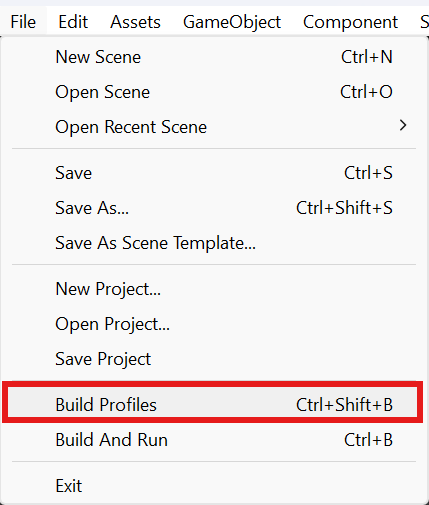
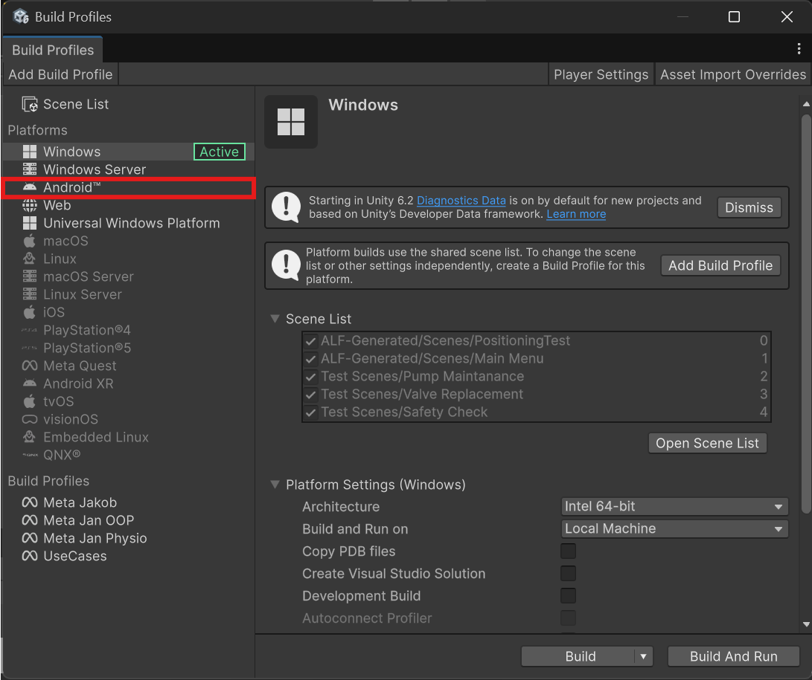
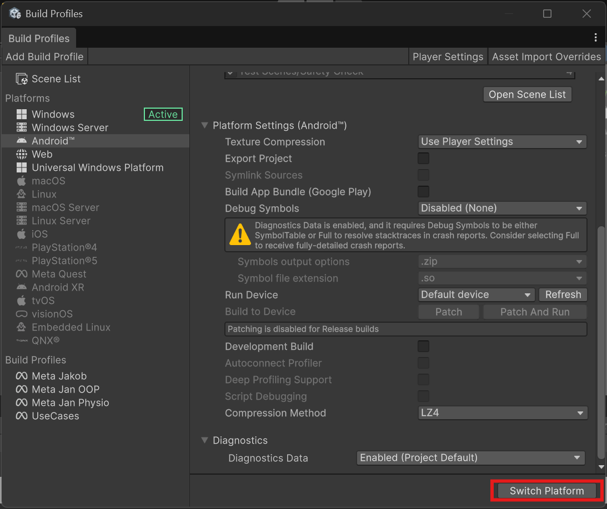

# Prepare Unity

## Install Android build support

All supported headsets are Android devices, so Unity needs the Android module before the project can be switched to Android.

1. Open **Unity Hub** and go to **Installs**.
2. Next to **Unity 6000.3**, click the gear icon and choose **Add modules**.
3. Tick **Android Build Support**, including **OpenJDK** and **Android SDK & NDK Tools**, and install.

## Switch the project to Android

Unity projects start out set up for **Windows**. The headsets are Android devices, so the project has to be switched to Android before you can build for them. You do this once; after that the project stays on Android.

1. In Unity's top menu, open **File > Build Profiles** (or press **Ctrl+Shift+B**).

   

2. Under **Platforms** on the left, click **Android**. The platform marked **Active** is the one the project is set up for at the moment, here still **Windows**.

   

3. Scroll down on the right and click **Switch Platform** at the bottom.

   

4. Wait until Unity is done. **Android** is then marked **Active**.

**What to expect:**

- **The first switch takes a while,** from several minutes to much longer. Unity converts every picture and model for Android. Don't close Unity while the progress bar is running.
- **Choosing a headset afterwards is quick.** The Meta Quest 3 and PICO 4 [build profiles](./build-profiles.md) are both Android profiles, so selecting one of them doesn't convert everything again.
- **Switching back to Windows** means waiting for the full conversion again. Avoid switching back and forth when you can.

:::tip[Check what's active]
In **File > Build Profiles**, the word **Active** shows what the project is set up for. Before building, make sure it's the profile for the headset that's connected.
:::

## Check the project

Open **ALF > Utils > Project Status** and fix anything it reports before building. A clean status here avoids most build problems.

## Set the scene list

The app contains only the scenes in the build profile's **Scene List**. The **first scene** in the list is the one that opens when the app starts.

1. Open **File > Build Profiles** and select **Scene List**.
2. Put the **main menu** scene at the **top**. The main menu then opens the lessons. See [Main Menu Setup](../tools/main-menu/index.md).
3. Add every **lesson scene** that the main menu links to. Lesson scenes made with [Scene Generation](../tools/scene-generation/index.md) are saved under `Assets/ALF-Generated/Scenes`.

:::info[Note]
*Placeholder: File > Build Profiles > Scene List, with the main menu first and the lesson scenes below.*
:::

:::caution[A lesson that isn't in the list won't open]
If a lesson is missing from the Scene List, its button in the main menu does nothing on the headset. Add new lessons here every time. See [Update the app on the headset](./update-the-app.md).
:::

## Set the app's name and version

In **Edit > Project Settings > Player**:

- **Product Name** is the name shown in the headset's app library.
- **Version** is the version number, for example `1.4`. Raise it when you put new lessons on the headsets, so you can tell versions apart.
- Under **Other Settings**, **Bundle Version Code** is a whole number. Raise it by one each time too.

:::caution[Leave the Package Name alone]
Under **Other Settings > Identification**, don't change the **Package Name**. If it changes, the headset installs a second copy of the app instead of updating the old one.
:::
