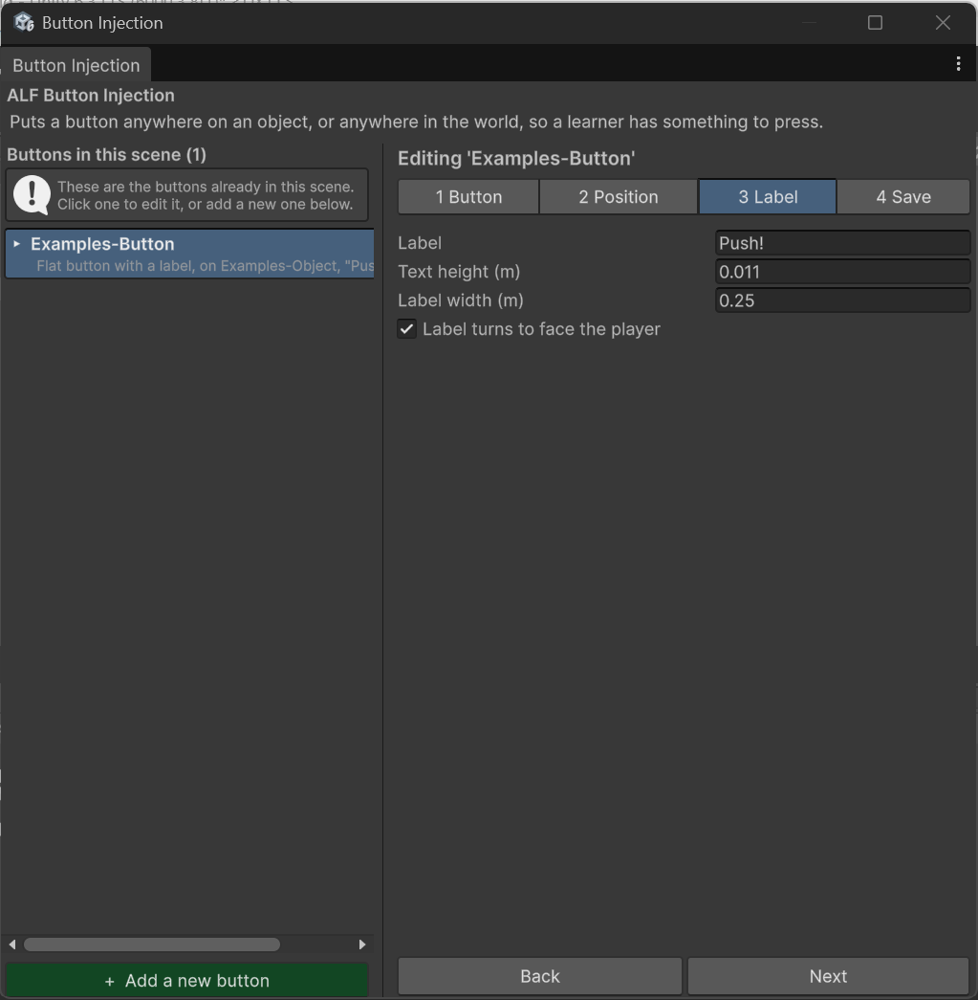

# Add a label to a button

**Goal:** show text above a button, such as "Start" or "Open valve", that learners can read from where they stand.

## If the button doesn't have a label yet

Only the *with a label* kinds have one. To add a label to an existing button:

1. Select the button in the list.
2. In step **1 Button**, change the **Type** to **Flat button with a label** or **Push button model with a label**.

The button is rebuilt as the new kind. Its position and settings are kept.

## Write the text

1. Select the button and open step **3 Label**.
2. Type the label text.

   

Each new button starts with an empty label, even if you copied the look of another button, so remember to fill it in.

## Make it readable

By default, a label tilts with its button. On a button lying flat, that means it can only be read from directly above. Choose how it should face instead:

| Option | What it does | Best for |
|---|---|---|
| **Turns to face the player** | Keeps turning towards the learner, wherever they stand. Stays upright. | Most labels. Learners can read it from anywhere. |
| **Held upright** | Stands vertically, whatever angle the button is at. | Labels that only need to be read from the front. |

If the label doesn't turn to face the player, use **Turn the label** to aim it in the direction learners will stand. This turns only the label, not the button.

## Change the text size

For flat buttons, set the **text height** in step 3 (between 1 mm and 500 mm). The panel around the text resizes to fit.

Push button models use their own label design, so the size fields aren't shown for them. Text, facing and turning still work.

## Good to know

- **Keep labels short.** The label has room for two lines. A third line spills out above the panel.
- **Save the scene** in step 4 when you're done.
