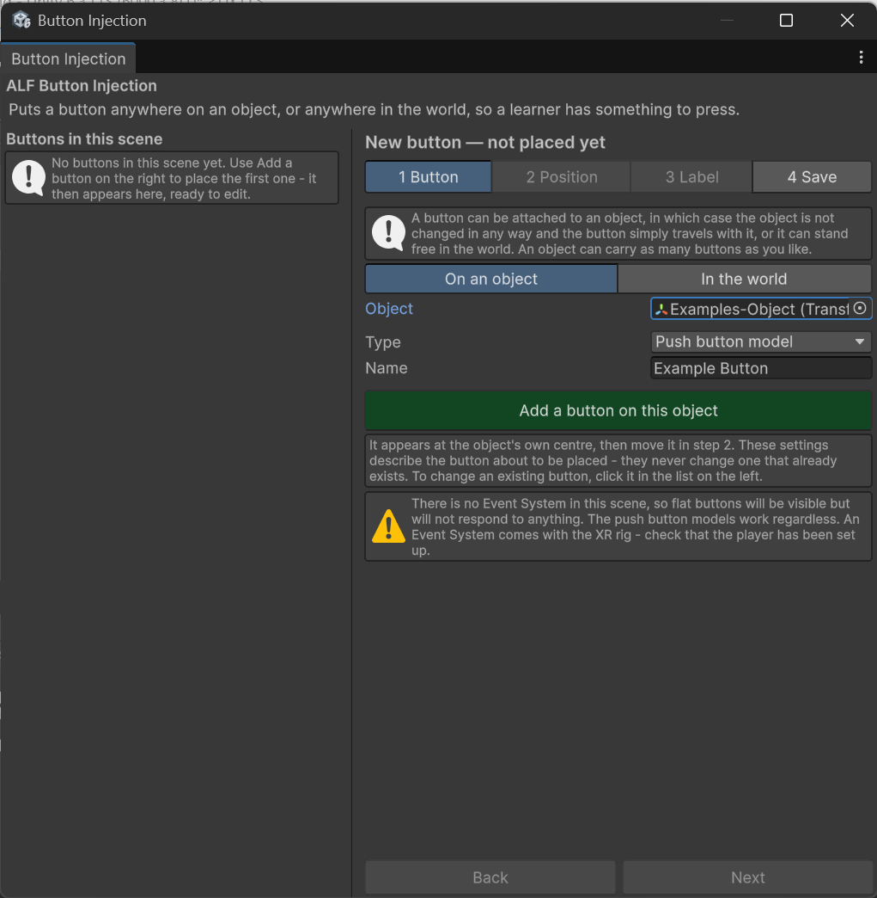

# Put a button on a machine

**Goal:** add a button that sits on an object, such as a machine or one of its parts, and moves with it.

The object itself isn't changed. The button is simply attached to it.

## Steps

1. Open **ALF > Interactivity > Button Injection**.
2. Under the list on the left, press **+ Add a new button**. The steps are now headed **New button — not placed yet**. In an empty scene, the window starts this way.
3. In step **1 Button**:
   1. For where the button goes, choose **On an object**.
   2. Drag the machine (or the part the button belongs on) from the **Hierarchy** into the object field.
   3. Choose the **Type**. See [Which kind of button?](./before-you-start.md#which-kind-of-button)
   4. Type a **Name**, for example `Start`. If you leave it empty, the button is named after the object.
   5. Press **Add**.

   

4. The new button appears at the **centre of the object** and is selected, with step **2 Position** open.
5. Move it to where it should be. See [Move and turn a button](./move-and-rotate.md).

   

6. Go to step **4 Save** and press **Save the scene**.

## Result

The button is listed on the left as *on* your object. When the object moves, the button moves with it. In the hierarchy you can see that the button is placed as a child of the object it is assigned to.

## Good to know

- **The button starts at the centre of the object**, which may be inside it and hidden. That's expected. Move it in step 2.
- **Names are kept unique.** If another button already has the name, a number is added to the end.
- **An object can have as many buttons as you like.** Repeat these steps for each one.
- **Placing a button doesn't make it do anything yet.** To make it advance the lesson, see [Use a button to advance a lesson step](./trigger-lesson-step.md).
- **Drag from the Hierarchy**, not from the Project window. The Hierarchy holds the objects in your scene.
