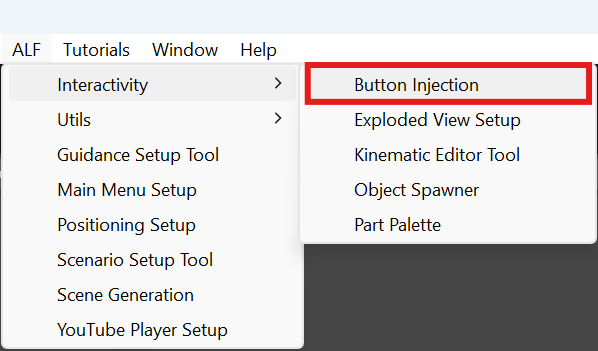
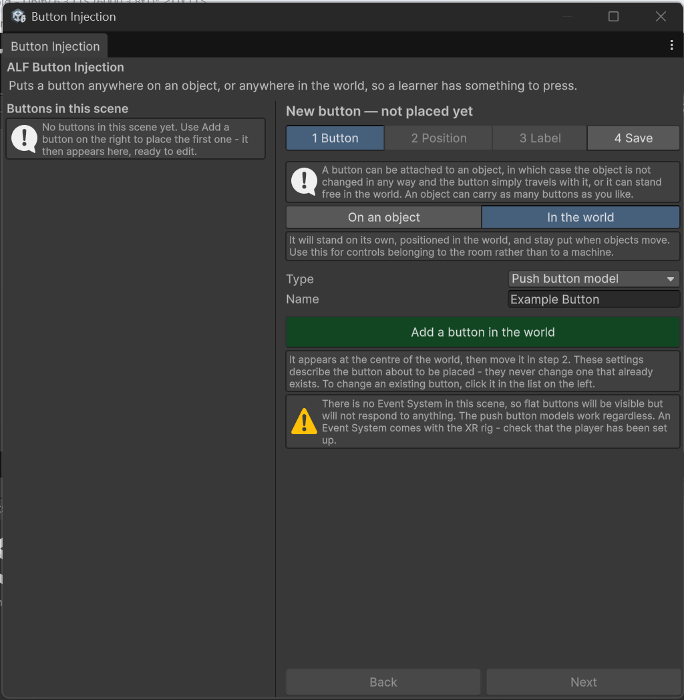

# Before you start

You don't need to know Unity well to use Button Injection. This page covers the few Unity terms the guides use, and what the tool's window looks like.

## Unity terms you'll see

| Term | What it is |
|---|---|
| **Scene** | The 3D room your lesson takes place in. |
| **Hierarchy** | The panel listing every object in the scene, usually on the left of the Unity editor. You'll drag objects from here into the tool. |
| **Scene view** | The large 3D view of the room, where you can look around and click on objects. |
| **Inspector** | The panel showing the settings of whatever is selected. You won't usually need it for buttons. |
| **Play mode** | Pressing **Play** at the top of the editor runs the lesson so you can try it. Changes made while playing are thrown away when you stop. |
| **Save the scene** | Keeps your changes. Until you save, your buttons exist only in the open editor. |

## Opening the tool

In Unity's top menu, choose **ALF > Interactivity > Button Injection**.

## What the window looks like

- **On the left:** every button already in the scene. Click one to change it.
- **On the right:** four steps, one at a time. Use the tabs or **Back** and **Next** to move between them.
- **The heading above the steps** always tells you what you're working on: `Editing '…'` for an existing button, or `New button — not placed yet` for one you're about to add.

Changes to an existing button appear in the scene **immediately**. You don't need to press an "apply" button. You only need to save the scene at the end.

:::caution[Don't set up buttons while the scene is playing]
Anything you change in Play mode is lost when you stop. Stop Play mode first.
:::

## Which kind of button?

| If you want… | Choose |
|---|---|
| A simple flat button, like a key on a panel | **Flat button** |
| The same, with text above it | **Flat button with a label** |
| A 3D push button that moves when pressed | **Push button model** |
| The same, with text above it | **Push button model with a label** |

You can change the kind later. See [Edit, rename or delete a button](./edit-rename-delete.md).
