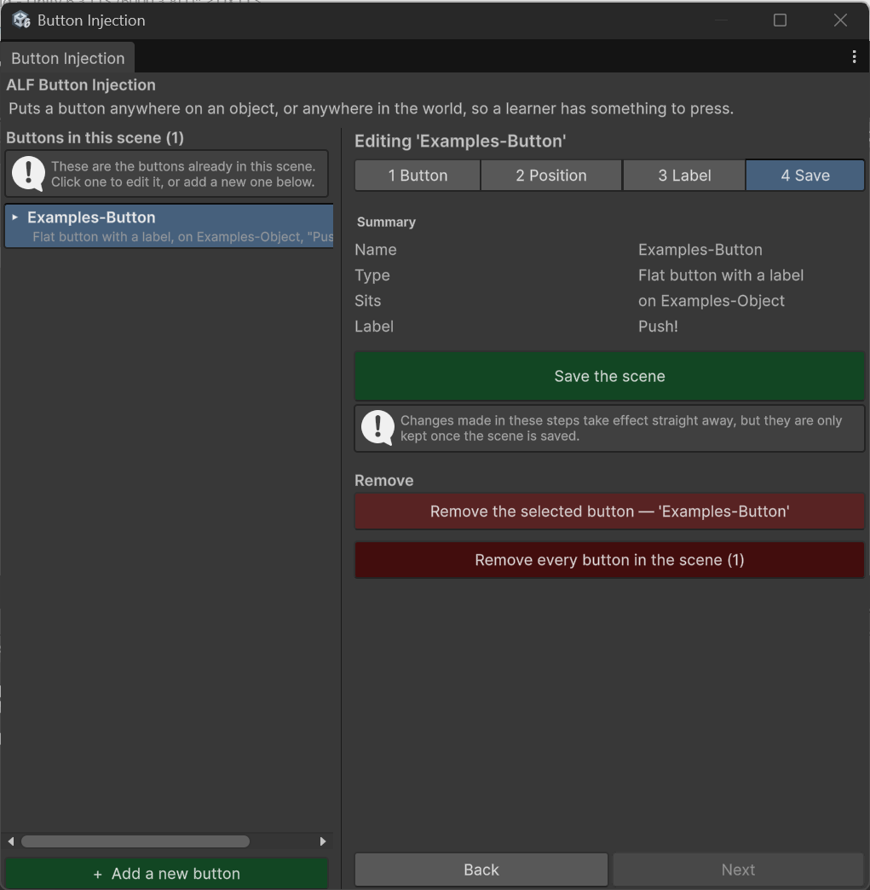

# Edit, rename or delete a button

## Find a button again

Every button in the scene is in the list on the left, including buttons that are switched off. Each row shows the button's name, its kind, and whether it sits on an object or in the world.

- **Click a row** to edit that button.
- **Press Find** next to a row to see where it is in the scene.
- You can also **click the button in the Scene view or Hierarchy** to select it.

While a button is selected, every change you make **applies to it straight away**.

## Rename a button

1. Select the button.
2. In step **1 Button**, change the **Name**. The button is renamed as you type.

If another button already has that name, you'll see a warning. Pick a different name so the two can be told apart.

## Change the kind

1. Select the button.
2. In step **1 Button**, choose a different **Type**.

The button is rebuilt as the new kind. Its position, label and settings are kept. Changes made to it by hand outside the tool are not.

## Add several buttons that look alike

1. Select the button whose look you want to reuse.
2. Press **+ Add a new button**, then set the type and name and press **Add**.

The new button copies the look of the first: orientation, sizes, label facing and options. It does **not** copy:

- the **label text**, because every button needs its own;
- the **position**, so the new button starts at the centre of its object (or of the world). Move it in step 2.

## Delete buttons

| To delete… | Do this |
|---|---|
| One button | Press **Delete** on its row in the list. |
| The button you're editing | In step **4 Save**, press **Remove the selected button**. The button names the button it will remove. |
| Every button in the scene | In step **4 Save**, press **Remove every button in the scene**. You'll be asked to confirm. |

:::danger[Remove every button means every button]
This removes all buttons on all objects in the scene, not just the selected one. It's the darker red button. Read the confirmation, which shows how many will be removed.
:::

After deleting, save the scene in step 4 to keep the change.
