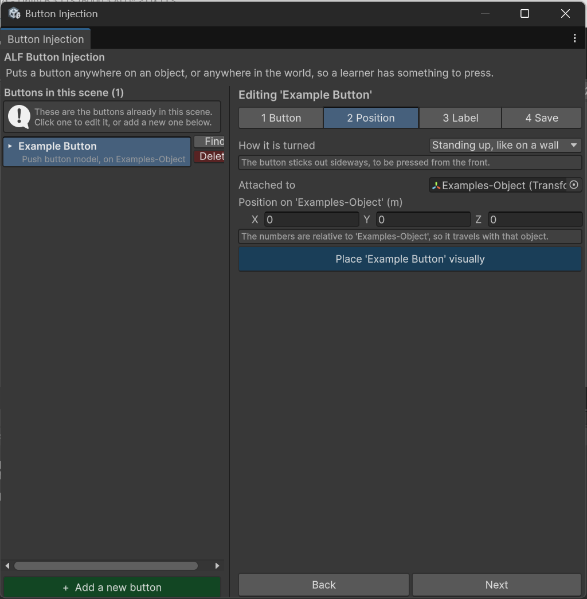
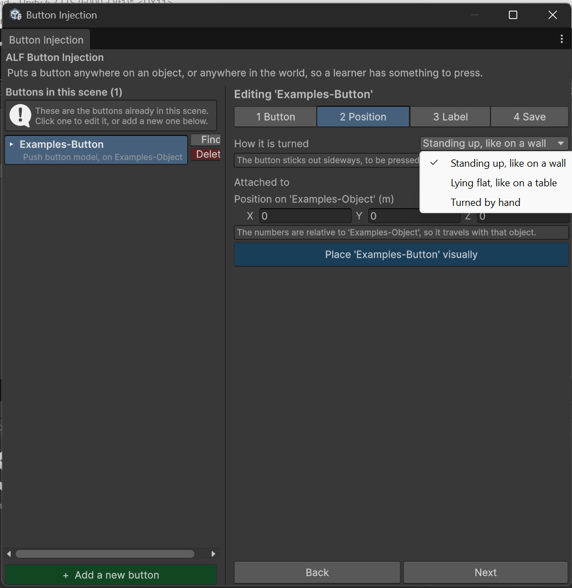

# Move and turn a button

**Goal:** put a button exactly where it should be, facing the right way.

## Select the button

Click the button in the list on the left. You can also click it in the **Hierarchy** or **Scene view**. The heading above the steps changes to `Editing '…'`.

Then open step **2 Position**.

## Set the position

You have two ways, and you can mix them:

- **Type coordinates** in metres. The field's label tells you what they're measured from:
  - `Position on 'Gripper'` means relative to that object's centre;
  - `World position` means relative to the centre of the world.
- **Place visually:** opens a separate window where you can move the button by eye. The coordinates update to match.

The button moves in the scene as you change the numbers.

## Turn it to match its surface

Choose an orientation:

| Option | Use it for |
|---|---|
| **Standing up** | A surface you look at, like the front of a control panel. |
| **Lying flat** | A surface you reach down to, like a table top. |
| **Manual** | Any other angle. Type the rotation yourself. |

The window describes in plain words what the chosen option will do.

Rotation is **relative to the object** the button sits on, so a button on a tilted machine tilts with it.

## Change the size

Flat buttons have a **size** setting in step **1 Button**, in metres. Push button models keep the size of their 3D model.

## Move a button to a different object

The window doesn't have a setting for this. Use the Hierarchy instead:

- **To put it on another object:** drag the button onto that object in the Hierarchy.
- **To make it free-standing:** drag it out to the top level of the Hierarchy, so it isn't inside any object.

The tool notices the change by itself, and the list updates.

:::caution[The button will jump]
The button keeps its old numbers, but they're now measured from somewhere else, so it will appear in a different place. Set its position again in step 2.
:::

## Good to know

- **Numbers are kept within sensible limits.** If a value snaps back after you type it, it was out of range. For example, a flat button can be between 5 mm and 2 m wide, and an offset can be at most 1000 m. This catches typos like a missing decimal point.
- Remember to **Save the scene** in step 4 when you're done.
