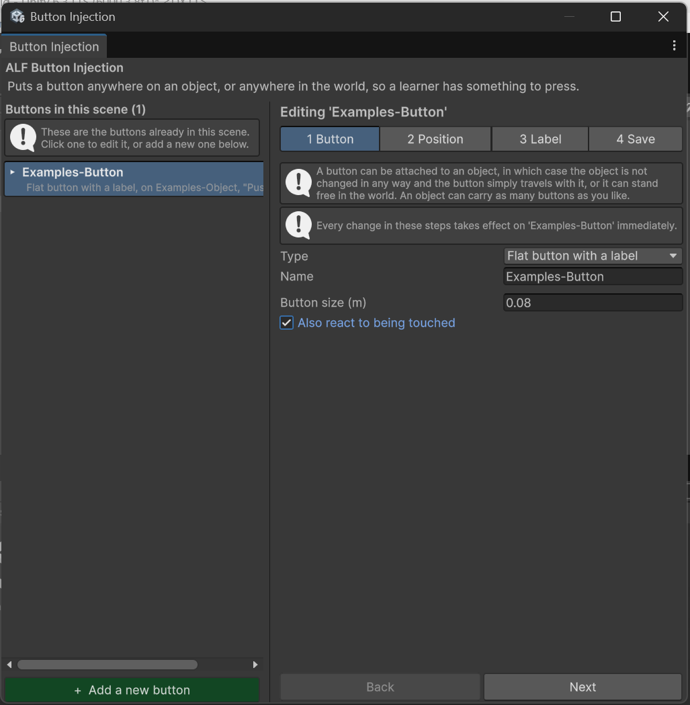

# Let learners press a flat button with a finger

**Goal:** let learners press a flat button by touching it, not only by pointing at it with a controller ray.

By default, a **flat button** can only be pressed with a controller ray. **Push button models** can already be pressed with a finger, so you don't need to do anything for them.

## Steps

1. Select the flat button in the list.
2. In step **1 Button**, tick **Also react to being touched**.

   

3. Save the scene in step **4 Save**.

## Result

The button can now be pressed both ways: with a controller ray and with a fingertip.

## Good to know

- If you use this button to [advance a lesson step](./trigger-lesson-step.md), it will appear under **both** trigger methods in the Scenario tool. Either choice works.
