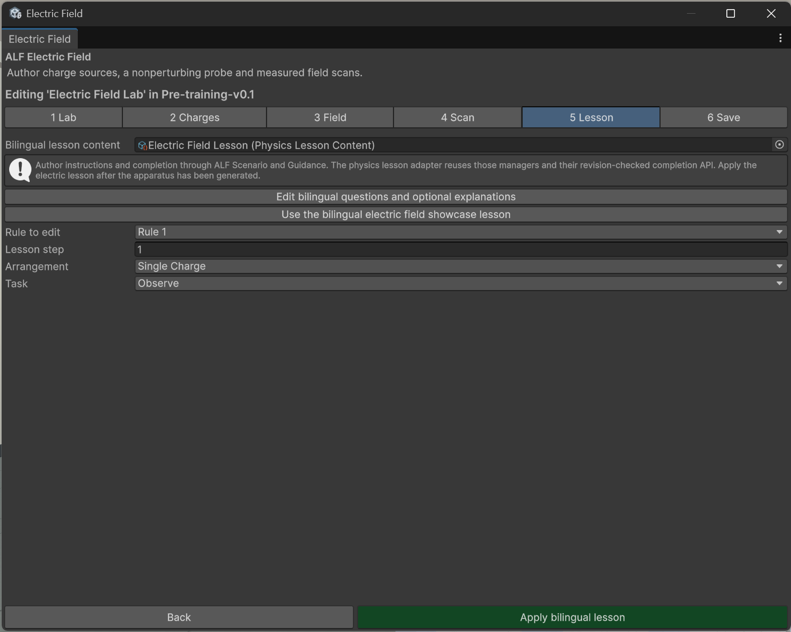

# Add the guided lesson

**Goal:** add step-by-step predictions and measurements, in English and German, that lead learners through the experiment.

## The ready-made lesson

The showcase lesson has ten steps:

1. Electric field laboratory (welcome)
2. Predict a single-charge field
3. Measure the single-charge field
4. Reverse the test charge
5. Predict two like charges
6. Measure like-charge superposition
7. Predict a dipole
8. Measure the dipole
9. Explain the evidence
10. Free exploration

Measuring steps ask learners to run a scan. They still decide themselves when to press **Next**, and all controls stay available, so they can experiment along the way.

## Steps

1. Create the lab first. See [Create a lab](./create-a-lab.md).
2. In step **5 Lesson**, press **Use the bilingual electric field showcase lesson**, or choose your own lesson file under **Bilingual lesson content**.
3. To change the questions, press **Edit bilingual questions and optional explanations**. Edit the English and German text of each step.
4. Under **Rule to edit**, check which **Lesson step** uses which arrangement and task.
5. Press **Apply bilingual lesson**.
6. Save the scene with **Ctrl+S**.

## Result

The lab gets a guided lesson with language controls, so learners can switch between English and German. The lesson's steps are written into the scene like any lesson from [Scenario Setup](../../scenario-setup/index.md).

## More languages

The lab comes with English and German. To add more languages, press **Enable runtime localization for this lab** in step 5, then **Open Localization & Translation Tool**. See [Let learners switch languages](../../text-import-export/how-to/switch-languages.md).

## Good to know

- **The questions are saved in a separate lesson file** in the project, so several labs can share them.
- **Apply the lesson after the lab.** Create and apply the lab first, then the lesson.
- **One lesson per scene.** The lab uses the scene's lesson steps.
- **The lab's texts aren't part of [Text Import & Export](../../text-import-export/index.md)'s file export.** Edit them here, or use runtime localization.
