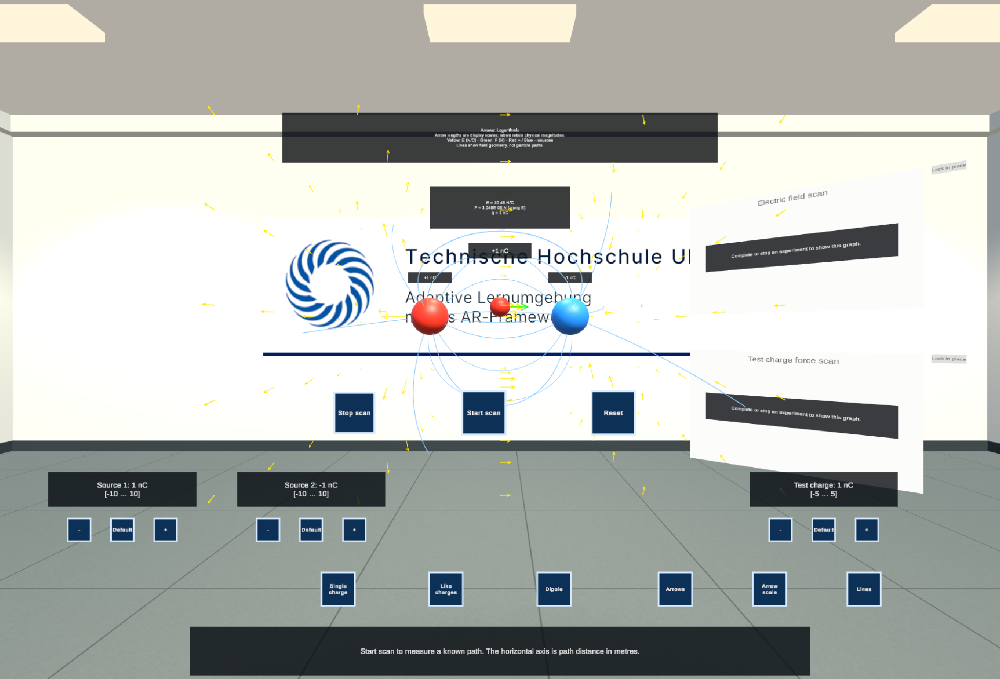
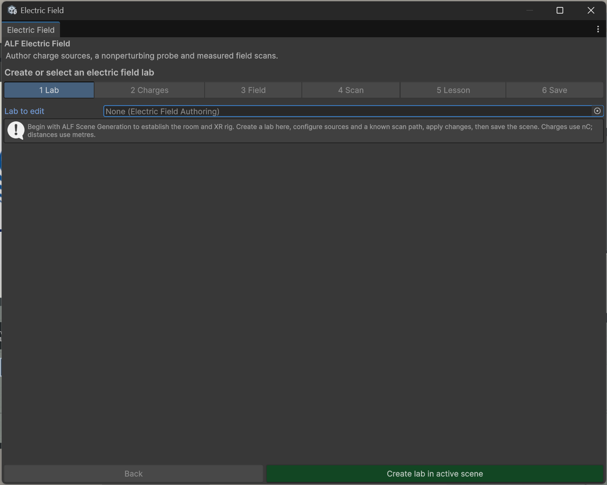

# What learners see and do

New to Unity? The basic terms (Scene, Hierarchy, Project window, Play mode) are explained in [Before you start](../../../before-you-start.md).

## What you need

A **lesson scene** with a room and a player setup, made with [Scene Generation](../../scene-generation/index.md). The lab doesn't set those up itself.

## What learners see

- **Charges** as spheres: red for positive, blue for negative. Each shows its charge in nanocoulombs (nC).
- **Arrows** for the field at points around the charges, in yellow.
- **Field lines** that show the shape of the field. They show the field's direction, not the path a particle would take.
- A **test probe** they can grab and move. Its readout shows the field **E** (N/C) and the force **F** (N) on the test charge at that point.
- A **graph** for the scan.
- A legend explaining the colours: *Yellow: E (N/C) · Green: F (N) · Red + / Blue − sources*.

## What learners can do

| Control | What it does |
|---|---|
| **Single charge**, **Like charges**, **Dipole** | Switch to a ready-made arrangement of charges. |
| **Arrows**, **Lines** | Show or hide the arrows and the field lines. |
| **Arrow scale** | Switch how arrow length shows field strength. The numbers in the readouts never change. |
| **Test charge** | Reverse the test charge, to see the force flip while the field stays the same. |
| **Start scan** / **Stop scan** | Move the probe along a straight path and plot \|E\| and \|F\| against the distance. |
| **Reset** | Put the charges and the probe back to their starting positions. |

With the guided lesson, the buttons are labelled in the language learners choose (English or German).

## Good to know

- **Readings near a charge are switched off.** Each charge has a small sphere around it in which no reading is shown, because the formula grows without limit there.
- **The model is simplified:** stationary point charges in a vacuum. The probe measures, but doesn't disturb, the field.

## The window

| Step | What you do there |
|---|---|
| **1 Lab** | Create the lab, or choose the lab to edit, and set where it stands. |
| **2 Charges** | Add up to four charges, and set their position, charge and excluded radius. Set where the probe starts. |
| **3 Field** | The area where arrows and lines are drawn, and how many. |
| **4 Scan** | The start and end of the scan path. |
| **5 Lesson** | Optional guided lesson in English and German. |
| **6 Save** | Apply the settings, save, or remove the lab. |

Charges are in **nC** (nanocoulombs), distances in **metres**.
