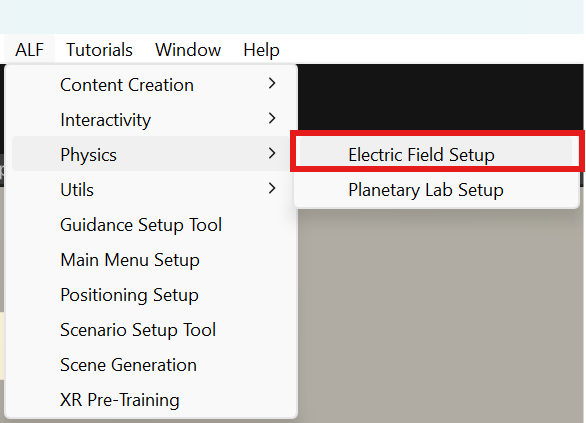
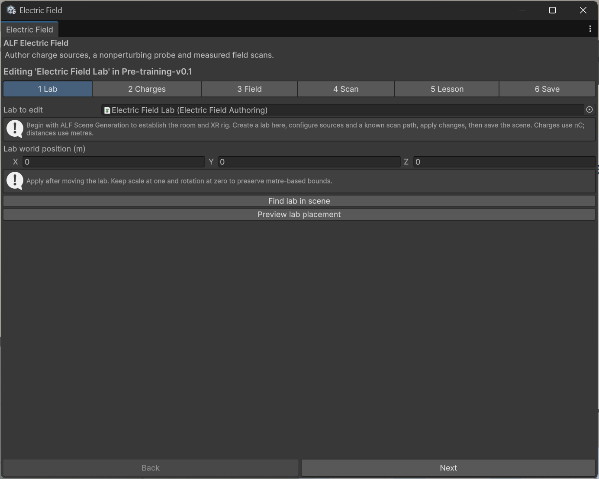
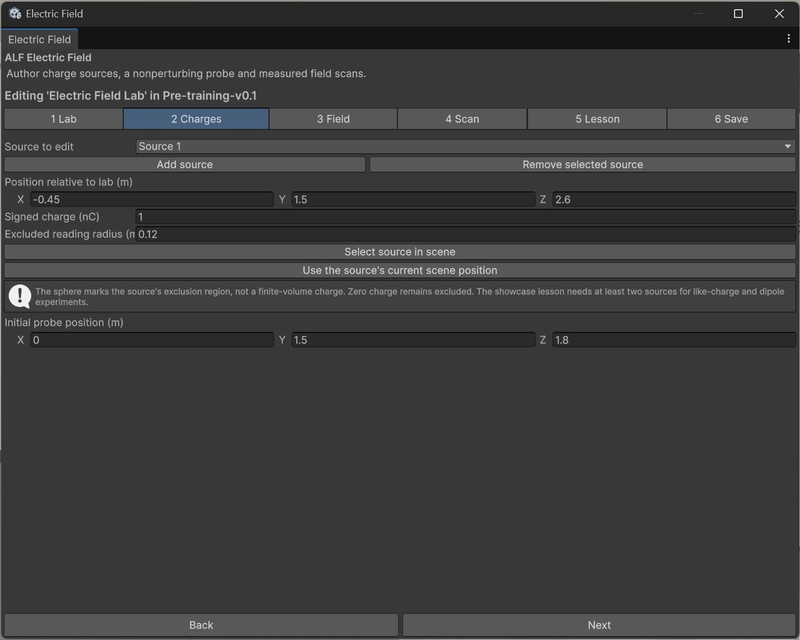

# Create a lab

**Goal:** add the experiment to your scene, with the charges and the scan path you want.

## Steps

1. Open your lesson scene, then **ALF > Physics > Electric Field Setup**.

   

2. In step **1 Lab**, press **Create lab in active scene**. This adds the lab, its controls and its graph. The rest of your scene stays as it is.
3. Still in step **1 Lab**, set the **Lab world position (m)**. **Preview lab placement** shows it in a separate preview.

   

4. In step **2 Charges**, set up the charges:
   - **Source to edit**: pick a charge. **Add source** adds one (up to four), **Remove selected source** removes it.
   - **Position relative to lab (m)**: where the charge floats.
   - **Signed charge (nC)**: positive or negative, for example `5` or `-5`.
   - **Excluded reading radius (m)**: the small sphere around the charge where no reading is shown.
   - **Initial probe position (m)**: where the test probe starts.

   Moved a charge in the Scene view? **Use the source's current scene position** copies its position into the window.

   

5. In step **3 Field**, set where arrows and lines are drawn:
   - **Display center relative to lab (m)** and **Display size (m)**: the box around the charges.
   - **Samples per axis**: how many arrows are drawn per direction.
   - **Maximum field lines**: how many field lines.

   More arrows and lines look denser, but cost performance in the headset. Keep the defaults unless you have a reason.

6. In step **4 Scan**, set **Scan start** and **Scan end relative to lab (m)**: the straight path the probe follows when learners press **Start scan**. Keep the path outside every charge's excluded sphere.
7. Optional: step **5 Lesson**. See [Add the guided lesson](./add-the-lesson.md).
8. In step **6 Save**, press **Apply lab settings**, then save the scene with **Ctrl+S**.
9. Press Play to try it.

## Good to know

- **Keep the lab upright and at its normal size.** Don't tilt or scale it, so distances stay in real metres.
- **Moved the lab?** Press **Apply lab settings** again.
- **Find lab in scene** in step 1 selects it in the scene.
- **A warning at the bottom of the window** tells you if a setting doesn't fit. **Apply lab settings** stays greyed out until it's fixed.
- **The guided lesson needs at least two charges**, for its like-charge and dipole steps.
- **The tool doesn't work in Play mode.** Stop Play mode first.
