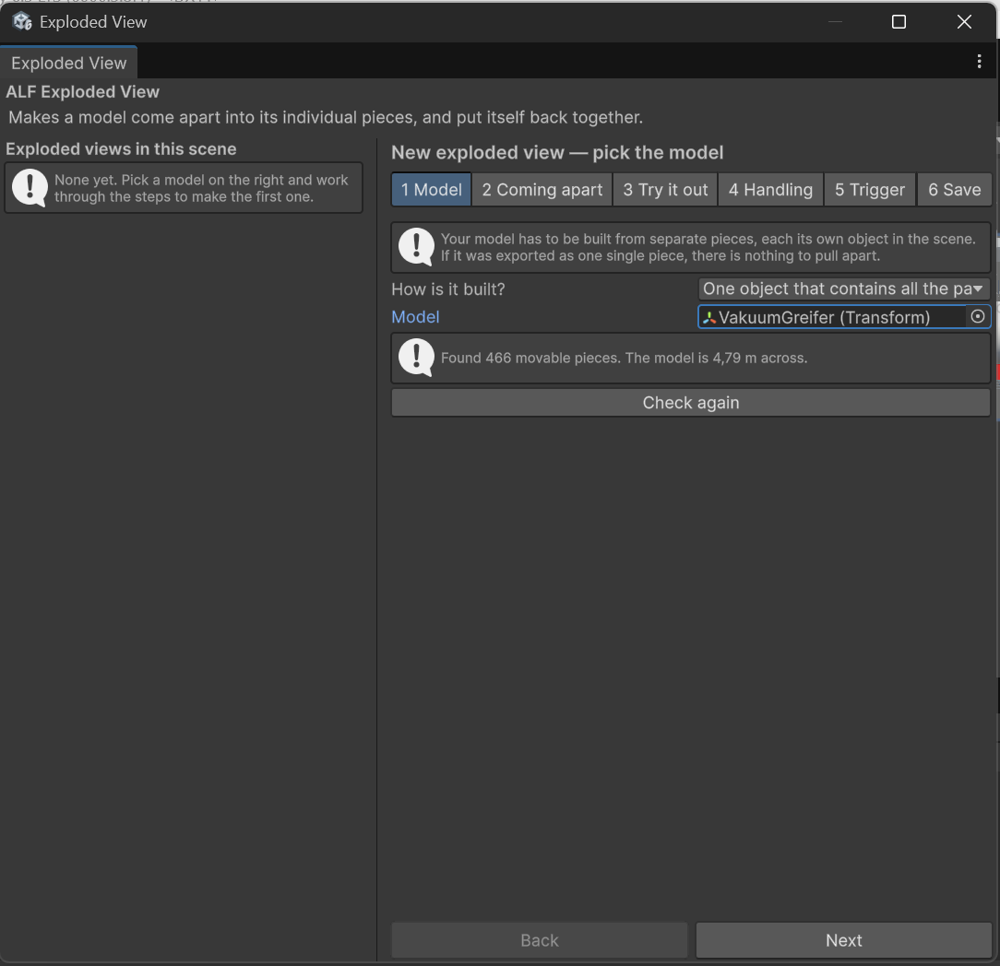

# Models that can come apart

An exploded view pulls a machine apart so learners can see every piece, then puts it back together. This page covers what your model needs, and what the tool's window looks like.

New to Unity? The Unity terms used here (Scene, Hierarchy, Scene view, Play mode) are explained in [Before you start](../../../before-you-start.md).

## Check your model first

The model must be made of **separate pieces, one object per part**. The tool moves those objects; it can't cut a single solid model into pieces.

To check, find the model in the **Hierarchy** and click the small arrow next to it to expand it:

- **You see many objects inside it**, each one a part (bolts, plates, motors…): the model is ready.
- **It's one object with nothing inside it**: the model is a single mesh. The tool will refuse it. Ask whoever prepared the model to export it again with its parts kept separate.

:::tip[Use the model from the Hierarchy]
Always use the copy of the model that's **in your scene**, which you find in the Hierarchy, not the file in the **Project** window. The tool refuses the Project file, because changing it would change every copy in every scene.
:::

## Opening the tool

In Unity's top menu, choose **ALF > Interactivity > Exploded View Setup**.

## What the window looks like

- **On the left:** every exploded view already in the scene, with how many pieces each has.
- **On the right:** six steps, one at a time.

| Step | What you do there |
|---|---|
| **1 Model** | Choose the model. If the model is a prefab, unpack it first: right-click it in the Hierarchy and choose **Prefab > Unpack Completely**.  |
| **2 Coming apart** | Set how far and in which direction the pieces move. |
| **3 Try it out** | Watch it come apart in the scene. |
| **4 Handling** | Decide whether learners can pick up the pieces. |
| **5 Trigger** | Decide what opens the model: a lesson step, a button, or both. |
| **6 Save** | Save the setup into the scene. |

Steps 2 to 6 stay locked until step 1 has a model that can come apart. If they're locked, step 1 tells you why.

:::caution[Not while the scene is playing]
The window is read-only in Play mode, because anything set up while playing would be lost. Stop Play mode first.
:::
