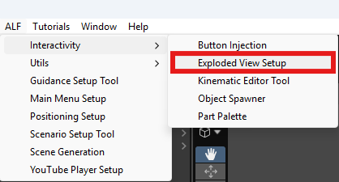
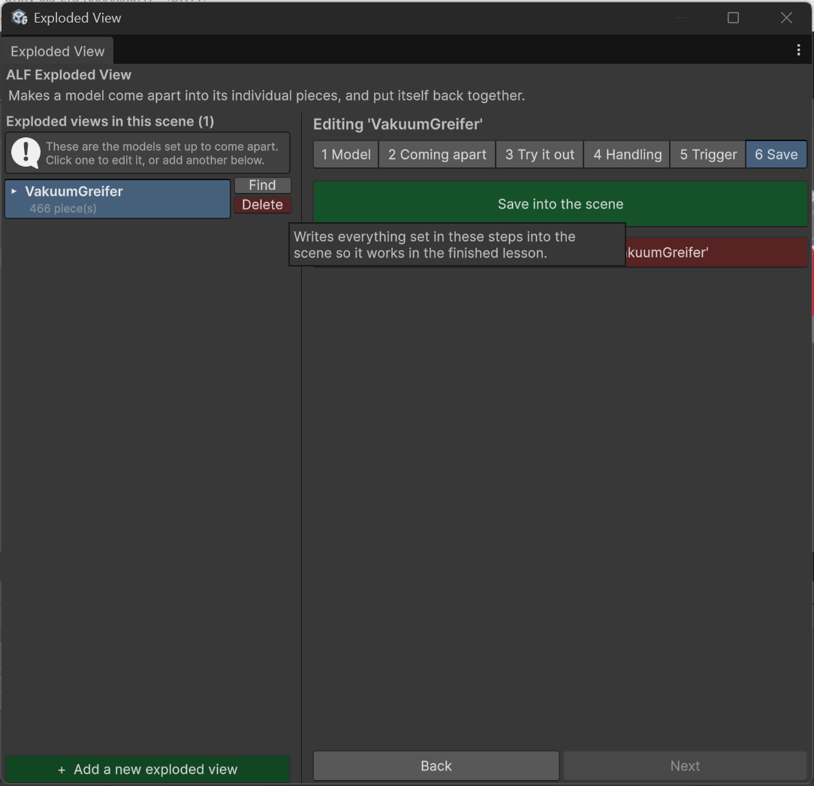

# Edit or remove an exploded view

## Change an existing exploded view

1. Open **ALF > Interactivity > Exploded View Setup**.

   

2. Click the model in the list on the left. The steps are headed `Editing '…'`.
3. Change what you need in steps 2 to 5.
4. In step **6 Save**, press **Save into the scene**, then save the scene with **Ctrl+S**.

   

To see a model in the scene, press **Find** next to it in the list.

## If you moved a piece of the model

The exploded view remembers where every piece belongs when it's assembled. That's recorded when you save.

If you move a piece in the scene afterwards, it would jump back to its old place the next time the model closes. The window warns you about this, including next to the save button in step 6, and tells you how far the pieces have moved.

**To keep the new position:** press **Save into the scene** again in step 6.

## Remove an exploded view

| Where | What it does |
|---|---|
| **Delete** next to the model in the list | Removes that exploded view. |
| **Remove** in step 6 | Removes the exploded view you're editing. The button names the model it will act on. |

Removing puts every piece back in its place and deletes everything the tool added, including its buttons. The model itself is not deleted.

Save the scene with **Ctrl+S** afterwards.

## If you deleted the model but not the exploded view

The window notices that the exploded view has nothing left to move and offers a **Remove** button in step 1.
