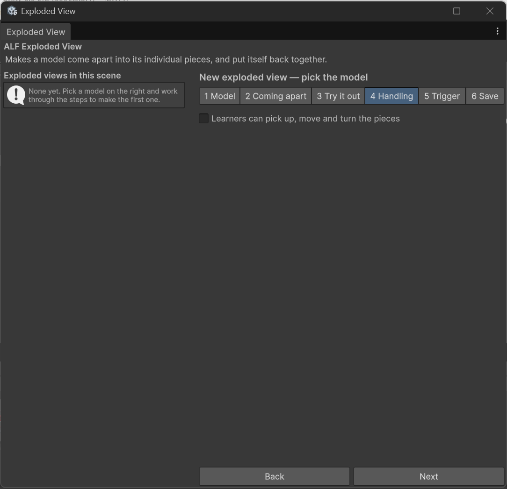

# Let learners pick up the pieces

**Goal:** let learners grab a piece of the open model, turn it over, and look at it closely.

## Steps

1. Select the exploded view in the list on the left.
2. Open step **4 Handling** and tick **Learners can pick up, move and turn the pieces**.

   

3. Choose the other options:

   | Option | What it does |
   |---|---|
   | **Two hands can also resize a piece** | Learners can make a piece bigger or smaller by holding it with both hands and pulling apart. |
   | **Pieces find their own way back** | A piece the learner lets go of returns to its place by itself. Untick it to leave pieces where the learner put them until the reset button is pressed. |
   | **Wait before returning** | How many seconds a piece stays where it was dropped before going back. |
   | **Journey back takes** | How many seconds the trip back takes. Zero makes it jump back instantly. |

4. In step **6 Save**, press **Save into the scene**, then save the scene with **Ctrl+S**.

## How it behaves for learners

- **Pieces can only be picked up while the model is fully open**, not while it's opening or closing.
- **Pieces can't be thrown.** Letting go of a piece leaves it where it is.
- **The model waits for its pieces before closing.** If a learner has moved pieces, they first fly back to their places, then the model closes.
- **Turned and resized pieces are put right.** When the model closes, every piece gets its original size and angle back.

## Add a reset button

A reset button sends every piece back to its place immediately. It works at any time, even while the model is moving.

1. In step **4 Handling**, turn on the reset button.
2. Save as usual.

The reset button stands 25 cm beside the open/close button. Both currently look the same, so consider adding a label nearby, for example with [Button Injection](../../button-injection/how-to/add-free-standing-button.md).

## Good to know

- **Very small pieces:** under **Advanced settings**, *Smallest pickable piece* stops tiny pieces such as washers from being grabbable. They still come apart with the rest.
- **Large models in a headset:** the window warns when more than 400 pieces are grabbable, which is a lot for a headset. Raise *Smallest pickable piece* to reduce the number.
