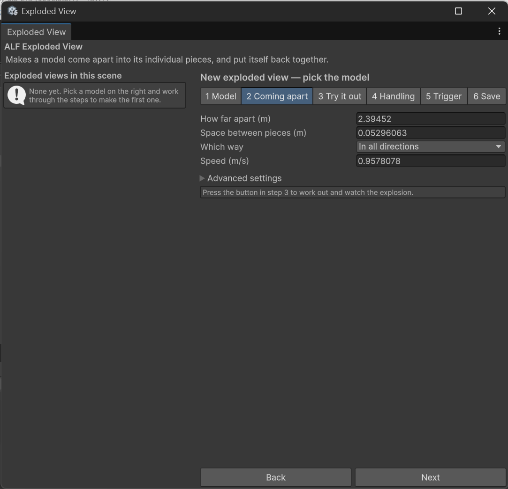
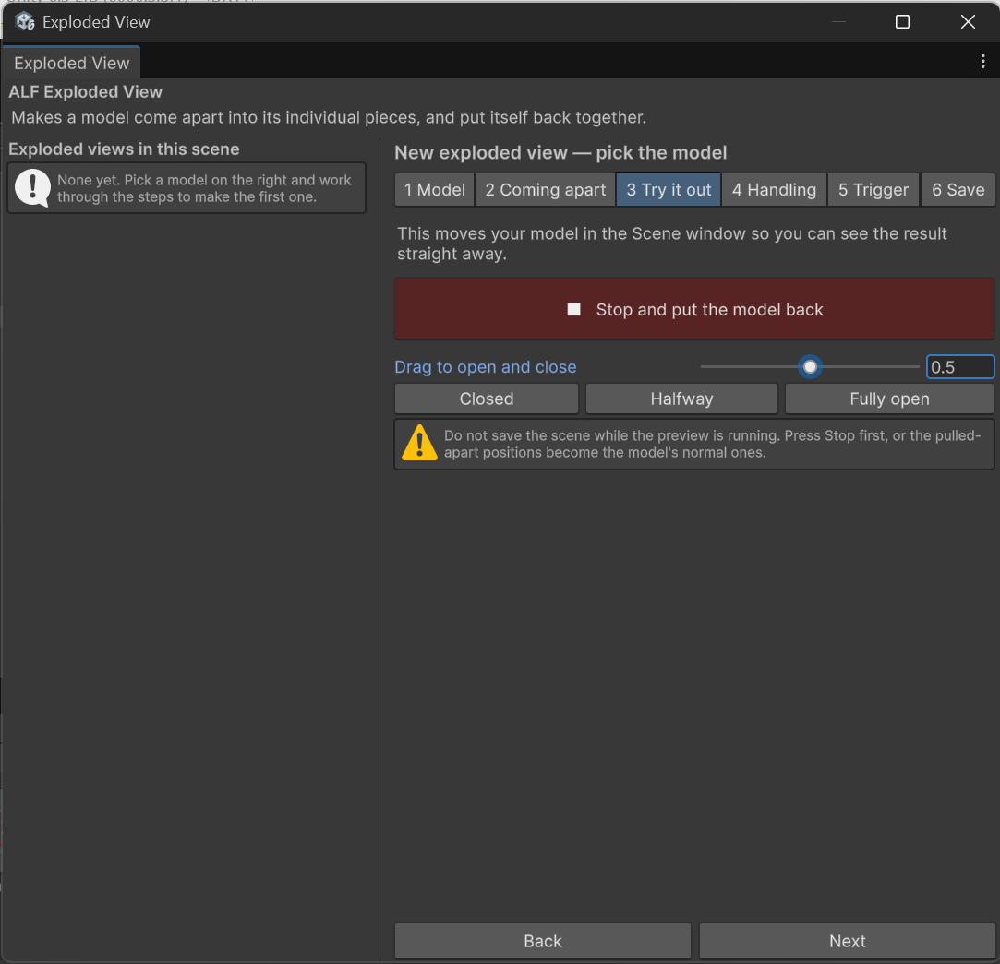
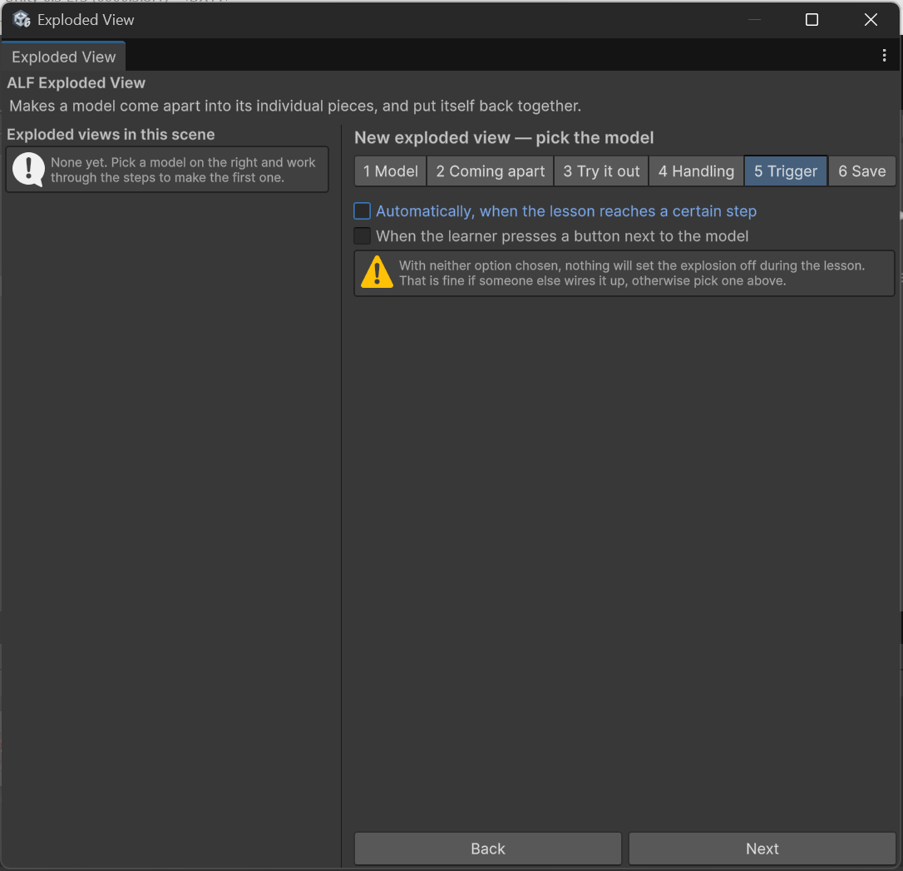

# Make a model come apart

**Goal:** set up a model so it pulls apart into an exploded view and goes back together.

## Steps

1. Open **ALF > Interactivity > Exploded View Setup**.

   

2. If the steps are headed `Editing '…'`, press **+ Add a new exploded view** under the list first.
3. **Step 1 Model:** drag your model from the **Hierarchy** into the model field.
   The window reports how many pieces it found, how big the model is, and anything that may cause problems. Read these messages before going on.

   

4. **Step 2 Coming apart:** the distances are already filled in, worked out from the size of your model. Leave them for now. You can [adjust them later](./adjust-the-explosion.md).

   

5. **Step 3 Try it out:** press the large button. The real pieces move apart in the Scene view so you can see the result. Stopping the preview puts them back.

   

6. **Step 4 Handling:** decide whether learners can pick up the pieces. See [Let learners pick up the pieces](./let-learners-handle-pieces.md).

   

7. **Step 5 Trigger:** choose what opens the model. See [Open the model at a lesson step](./open-at-a-lesson-step.md) or [Add a button that opens the model](./add-a-push-button.md).

   

8. **Step 6 Save:** press **Save into the scene**, then save the scene itself with **Ctrl+S**.

   

## Result

The model is listed on the left with its number of pieces. In the lesson, it opens and closes on the trigger you chose.

## Good to know

- **Only the pieces move.** Grouping objects inside the model stay where they are. The tool moves the smallest pieces, while still keeping parts that belong together (like a bolt with its nut and washer) together.
- **The preview is always undone for you.** Stopping the preview, closing the window, saving the scene or pressing Play all put the model back together first, so a pulled-apart model is never saved by accident.
- **If you have several machines**, give each one its own exploded view. See [Explode only part of a machine](./explode-part-of-a-machine.md).
