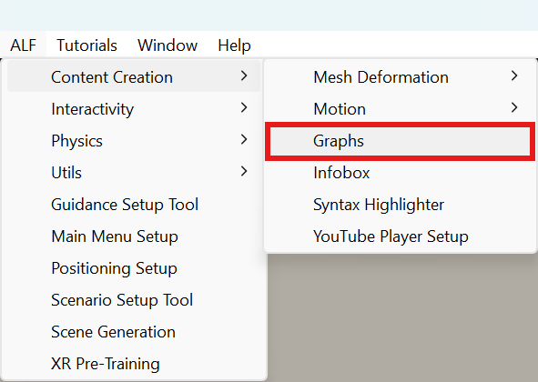

# Make a graph from formulas

**Goal:** draw one or more functions, for example `sin(x)` and `cos(x)`, over a range you choose.

## Steps

1. Open **ALF > Content Creation > Graphs**.

   

2. In step **1 Data**, select **Formulas**.
3. Under **Variable and range**, set:
   - **Variable**: the name in your formulas, `x` by default (or `n` for sequences);
   - **From**, **To** and **Step**: the values it runs through;
   - **Angles**: **Radians (sin(pi/2) = 1)** or **Degrees (sin(90) = 1)**.
4. Type a formula, and give it a **Name**. Press **+ Add a formula** for each further line in the graph.
5. Check the **Preview**. Mistakes are explained under the formula, for example *Did you mean sin(x)?*.
6. Press **Compute and add the graph to the scene**.

Then continue with [Choose the chart](./choose-the-chart.md), [Change the look](./change-the-look.md) and [Place the graph](./place-the-graph.md), and press **Save the scene** in step **5 Save**.

## Writing formulas

| You write | Meaning |
|---|---|
| `+ - * / ^` | Add, subtract, multiply, divide, power. `·`, `×`, `÷` and `:` work too. |
| `2x`, `3x^2`, `(x-1)(x+1)` | Multiplication without a sign. |
| `x²`, `x³`, `√x`, `5!` | Square, cube, square root, factorial. |
| `pi`, `π`, `e` | Constants. |
| `sin cos tan asin acos atan` | Trigonometry, in radians or degrees as chosen. |
| `sqrt abs ln exp floor ceil round` | Common functions. |
| `log(x)`, `log(x, b)` | Logarithm to base 10, or to base b. |
| `min(a, b)`, `max(a, b)`, `mod(a, b)` | Smallest, largest, remainder. |
| `sum(k, 1, n, 1/k^2)` | Sum over k from 1 to n, for series. `prod(…)` works the same for products. |

Use a **decimal point**: `0.5`, not `0,5`.

## Good to know

- **Gaps are fine.** Where a formula has no value, such as `sqrt(x)` below 0 or `1/x` at 0, the line simply has a gap.
- **Change the formulas later** with **Change the formulas…** on the selected graph.
- **The values are computed once** and stored, like an imported file.
