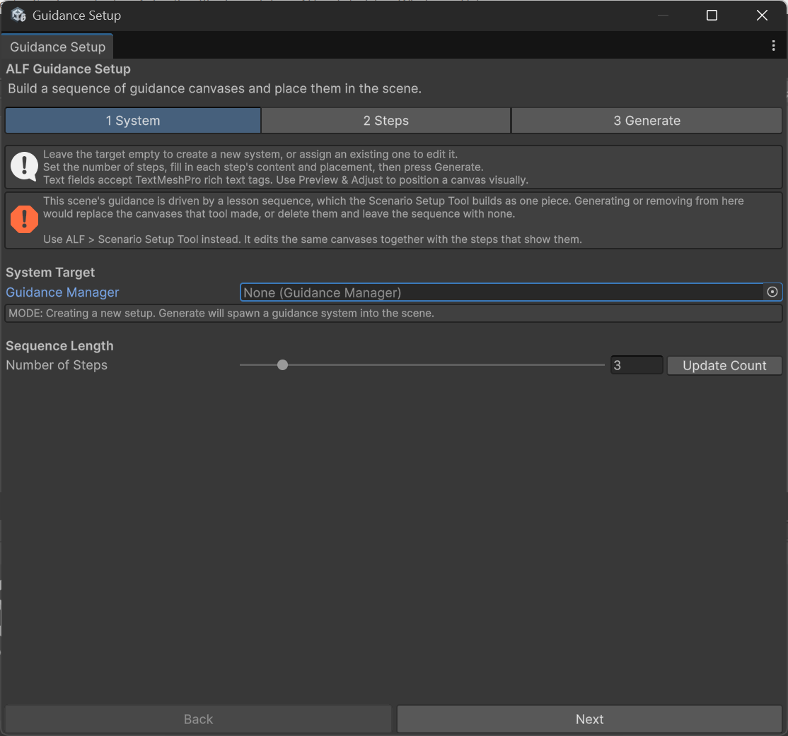
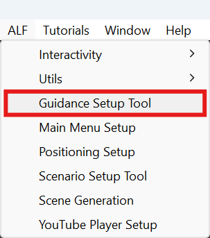

# Before you start

A guidance sequence is a series of instruction panels. The learner reads one panel at a time and moves through them with the panel's buttons:

- **Next** goes to the next panel.
- **Previous** goes back one panel.
- The last panel has a button to **end** the sequence.

If a panel is out of view, an arrow near the learner points towards it.

New to Unity? The basic terms (Scene, Hierarchy, Project window, Play mode) are explained in [Button Injection: Before you start](../../button-injection/how-to/before-you-start.md#unity-terms-youll-see).

## Guidance or Scenario?

| Use | When |
|---|---|
| **Guidance Setup** | You only need instruction panels, and the learner always moves on with **Next**. |
| **Scenario Setup** | Steps should also **change the room** (show or hide objects), or finish another way: walking to a place, or pressing a button. |

:::caution[One or the other]
If the scene already has a scenario made with [Scenario Setup](../../scenario-setup/index.md), this tool can show the panels but won't change them. Use Scenario Setup to edit them, because it handles the panels and the steps together.
:::

## Opening the tool

In Unity's top menu, choose **ALF > Guidance Setup Tool**. The window has three tabs:

| Tab | What you do there |
|---|---|
| **1 System** | Start a new sequence or edit the one in the scene, and set the number of steps. |
| **2 Steps** | Fill in each panel. The list of steps is on the left, the selected step on the right. |
| **3 Generate** | Check for warnings, then build the panels into the scene. |

What you type in tabs 1 and 2 is a draft. Nothing changes in the scene until you press the button in tab **3 Generate**.
