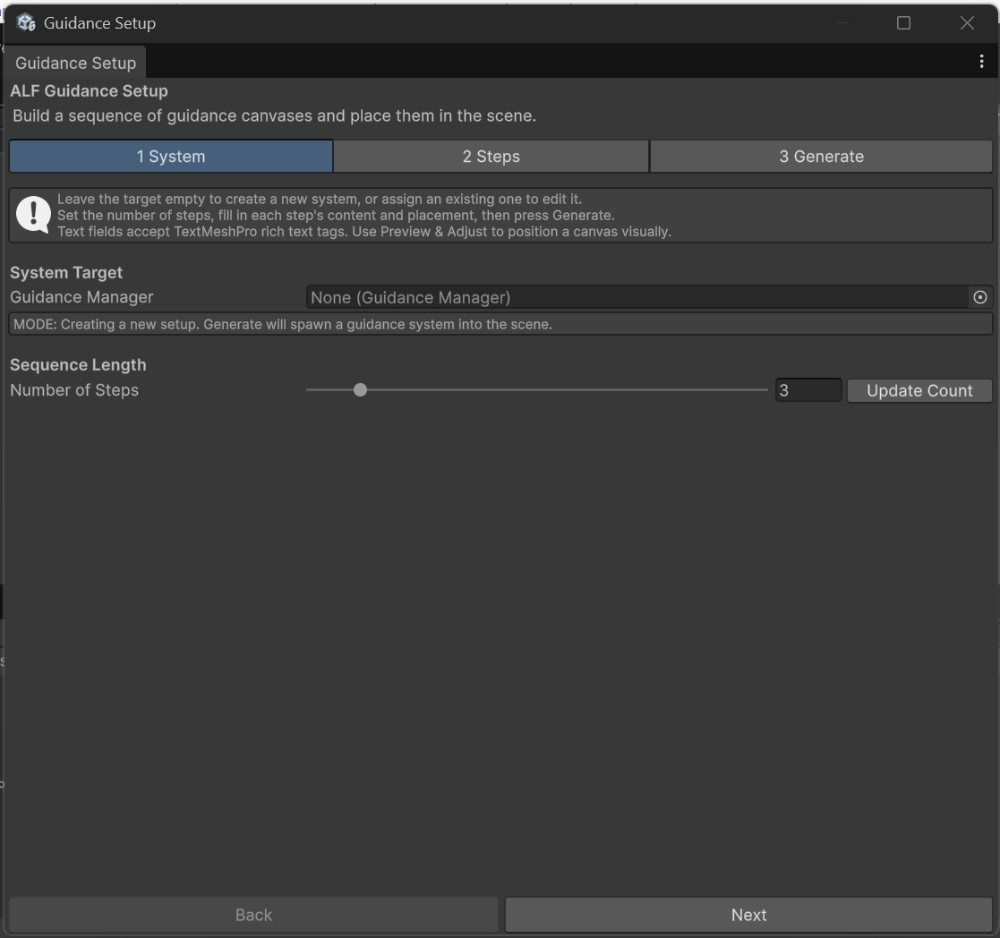
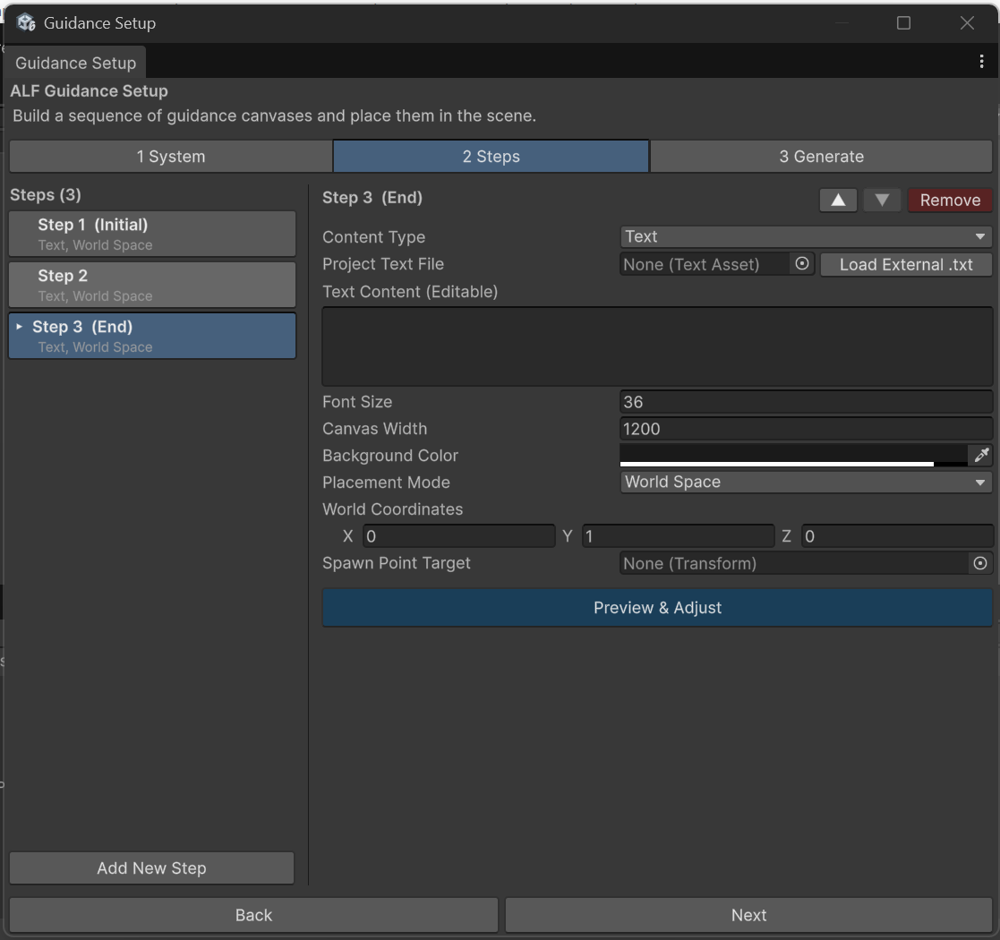

# Create a guidance sequence

**Goal:** build a series of instruction panels, from start to finish.

## Steps

### 1 System

1. Open **ALF > Guidance Setup Tool**.

   

2. Under **System Target**, leave **Guidance Manager** empty. The box below says **MODE: Creating a new setup.**
3. Under **Sequence Length**, set **Number of Steps** and press **Update Count**. You can have up to 20 steps.

   

### 2 Steps

4. Open tab **2 Steps** and click a step in the list.

   

5. Fill in what the panel shows. The fields are the same as in Scenario Setup: see [Write the instructions for a step](../../scenario-setup/how-to/write-the-instructions.md).
6. Choose where the panel appears. See [Place the instruction panel](../../scenario-setup/how-to/place-the-instructions.md).
7. Repeat for every step. To add, move or remove steps, use **Add New Step**, **▲**, **▼** and **Remove**, as described in [Add, reorder or remove steps](../../scenario-setup/how-to/manage-steps.md).

### 3 Generate

8. Open tab **3 Generate**. If warnings are listed, fix them first.

   

9. Press **Spawn New Guidance System**.
10. Save the scene with **Ctrl+S**.

## Result

The panels are built into the scene. Press **Play** to see the first panel.

## Good to know

- **Format text with tags,** for example `<b>bold</b>` or `<color=red>red</color>`.
- **Use Preview & Adjust** to place a panel by eye instead of typing coordinates.
