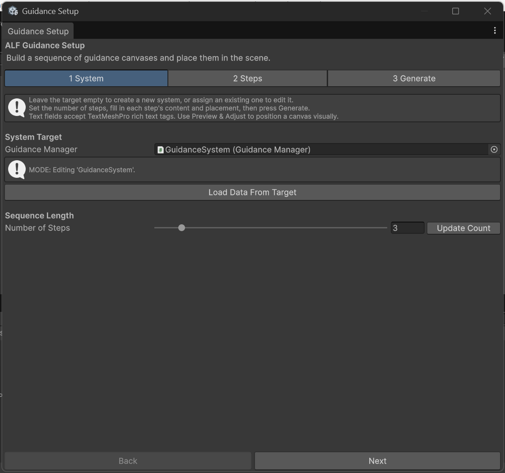
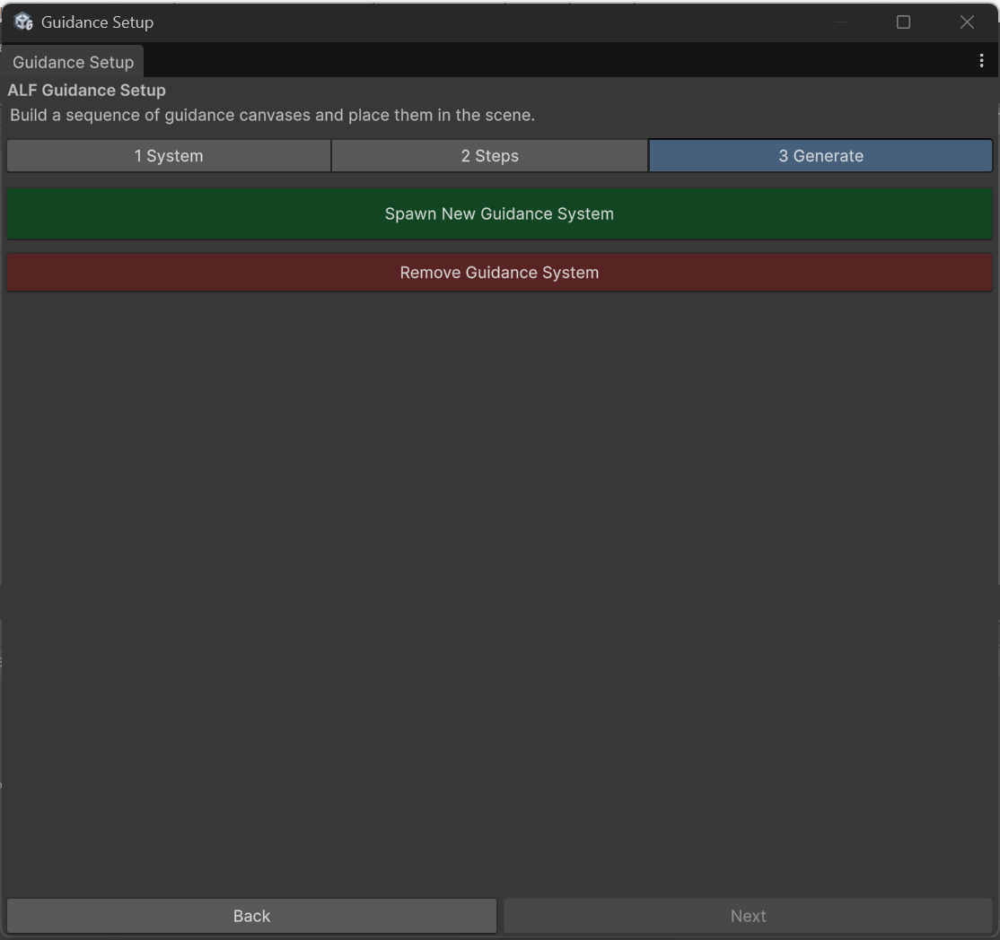

# Update or remove a guidance sequence

## Change an existing sequence

1. Open the scene.
2. Open **ALF > Guidance Setup Tool**. It finds the sequence in the scene and loads its steps. Tab **1 System** shows **MODE: Editing** followed by the sequence's name.

   

3. Make your changes in tab **2 Steps**.
4. In tab **3 Generate**, press **Update Existing Guidance System**.
5. Save the scene with **Ctrl+S**.

## Start again from what's in the scene

If your changes in the tool went wrong, press **Load Data From Target** in tab **1 System**. It throws away the changes you haven't generated yet, and reloads the steps from the scene.

## Remove the sequence

1. In tab **3 Generate**, press **Remove Guidance System**.

   

2. Confirm with **Yes, Remove**.
3. Save the scene with **Ctrl+S**.

This deletes the panels and the places they appeared at. Objects you chose yourself as a **Spawn Point Target** or **Attachment Target** are kept.

## Good to know

- **Switching to Scenario Setup later?** Open **ALF > Scenario Setup Tool** in the same scene. It picks up your existing panels, so you can add room changes and other ways to finish a step.
