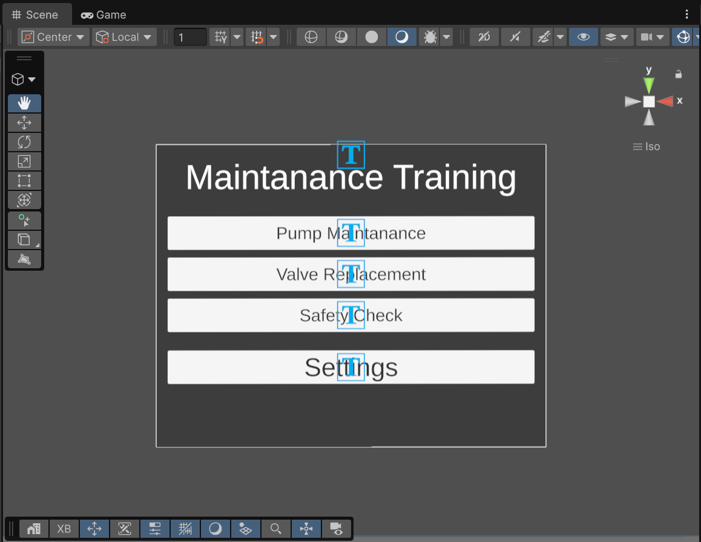
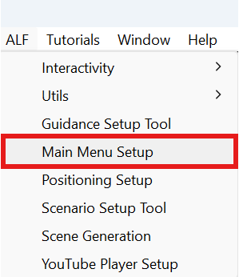

# How the start menu works

The main menu is the first thing learners see when they start the app. It's a scene of its own, with a panel listing your lessons:

New to Unity? The basic terms (Scene, Hierarchy, Project window, Play mode) are explained in [Before you start](../../../before-you-start.md).

## What you need first

- **Your lesson scenes**, made with [Scene Generation](../../scene-generation/index.md). The menu reads each lesson's player setup (VR or AR, controllers or hands) from the scene, so that the lesson opens correctly.
- **Good scene names.** The text on each button is the lesson's **scene file name**. A scene called `Pump maintenance` gets a button that says *Pump maintenance*.

:::tip[Rename a lesson's button]
To change a button's text, rename the scene file in the Project window, then [update the main menu](./update-the-main-menu.md).
:::

## VR or AR for the menu

The menu has its own player setup, chosen in **Menu Rig Mode**:

- **VR:** the menu stands in a standard VR room, which is added for you.
- **AR:** the menu floats in the real room, seen through the headset's cameras.

Each lesson still opens with **its own** setup, so a VR menu can open an AR lesson and the other way round.

## Opening the tool

In Unity's top menu, choose **ALF > Main Menu Setup**.

- **If the open scene is not a main menu,** the tool sets up a new one, and its heading says **Generate Main Menu**.
- **If the open scene is already a main menu,** the tool shows **Active Main Menu detected!** and lets you change it. The heading says **Update Main Menu**.
