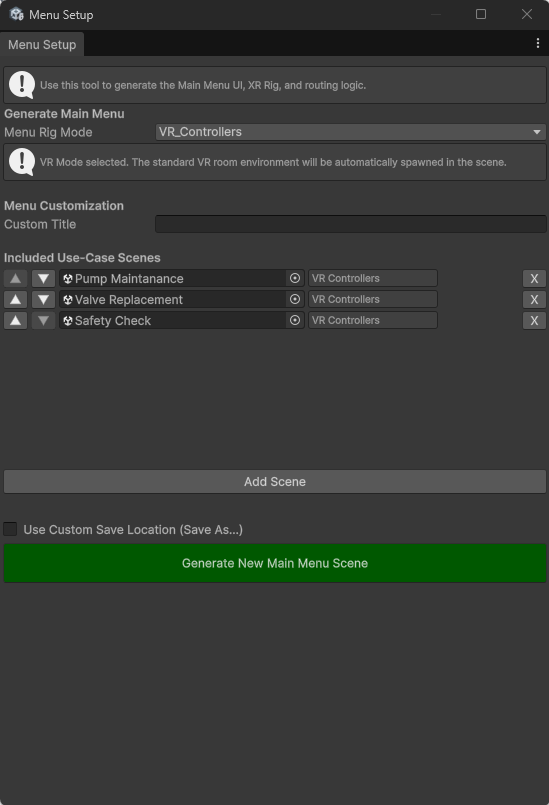

# Create the main menu

**Goal:** make the start scene of your app, with a button for every lesson.

## Steps

1. Open **ALF > Main Menu Setup**.

   

2. Choose the **Menu Rig Mode**: the player setup for the menu itself.

   The **player setup** (in Unity often called the *XR rig*) is everything in a scene that turns the headset into the learner's eyes and hands:

   - the **camera** that moves with the learner's head, so they can look around;
   - the **controllers** or the learner's **tracked hands**, with the rays and fingertips they point, press and grab with;
   - for **AR**, the **passthrough** that shows the real room through the headset's cameras;
   - for some setups, a way to **move around** the room.

   Without a player setup, the headset shows nothing and learners can't press the menu's buttons. You choose from the same five setups as in [Scene Generation](../../scene-generation/how-to/before-you-start.md#the-five-player-setups):

   | Menu Rig Mode | Learners use the menu… |
   |---|---|
   | **VR Controllers** | in a virtual room, pointing with the controllers |
   | **VR Hands** | in a virtual room, pointing and pinching with their hands |
   | **VR Hand Locomotion** | in a virtual room, with their hands, and can move around |
   | **AR Controllers** | in the real room, pointing with the controllers |
   | **AR Hands** | in the real room, pointing and pinching with their hands |

   In the list, the names are shown with underscores, for example `VR_Controllers`.

   Pick the setup learners will use when the app starts. It only affects the menu: each lesson opens with its own setup. See [VR or AR for the menu](./before-you-start.md#vr-or-ar-for-the-menu).

   

3. Under **Menu Customization**, type a **Custom Title**, for example `Maintenance training`.
4. Under **Included Use-Case Scenes**, add your lessons:
   1. Press **Add Scene**. An empty row appears.
   2. Drag the lesson's scene file from the **Project window** into the row.
   3. Check the box next to it. It shows the lesson's player setup, for example *VR Controllers*.
   4. Repeat for each lesson.
5. Put the lessons in the order they should appear, with **▲** and **▼**. To take one out, press **X**.
6. Optional: tick **Use Custom Save Location (Save As...)** to choose where the menu scene is saved.
7. Press **Generate New Main Menu Scene**.

## Result

- A new scene called `Main Menu` is saved in `Assets/ALF-Generated/Scenes`, or where you chose.
- It contains the menu panel with your title and one button per lesson, the player setup and, for VR, a room.
- The menu and all its lessons are added to the app's list of scenes (the **Build Settings**), so they're included when the app is built.

## Good to know

- **A red box next to a lesson** means the tool couldn't find a player setup in that scene (*No Player Detected*). Give the lesson one with [Scene Generation](../../scene-generation/how-to/update-an-existing-scene.md) first.
- **Lessons appear in the list order.** The first row is the top button.
