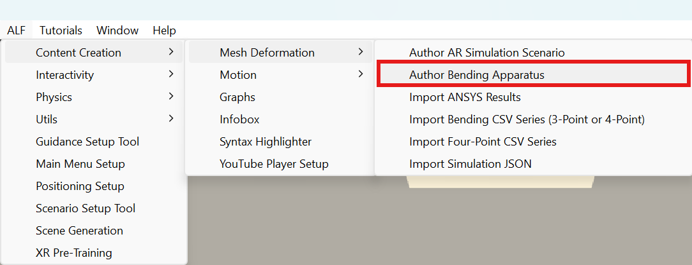
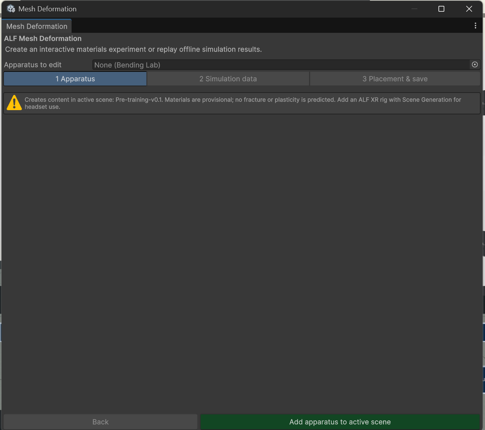
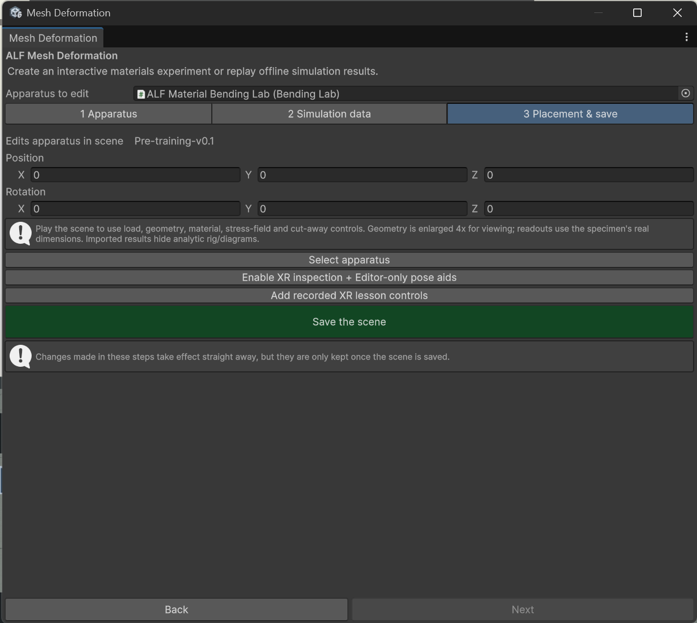

# Add a bending lab

**Goal:** put a bending lab into your scene and set it up.

## Steps

1. Open your lesson scene, then **ALF > Content Creation > Mesh Deformation > Author Bending Apparatus**.

   

2. In step **1 Apparatus**, press **Add apparatus to active scene**. This adds the specimen, its supports, default materials and controls.
3. Still in step **1 Apparatus**, set up the test:

   | Setting | What it is |
   |---|---|
   | **Materials** | The materials learners can compare, for example steel, aluminium and a polymer. |
   | **Experiment** | Three-point or four-point bending. |
   | **Span**, **Height**, **Width** (metres) | The specimen's dimensions and the distance between the supports. |
   | **Load** (newtons) | The force pressing down. |
   | **Exaggeration** | How much the bending is enlarged, to make it visible. |
   | **Stress range** | The range of the colour scale. |

   

4. Optional: in step **2 Simulation data**, add measured or simulated data. See [Import measured data](./import-lab-data.md) and [Import simulation results](./import-simulation-results.md). Without data, the lab calculates the bending itself.
5. In step **3 Placement & save**:
   - Set the **Position** and **Rotation** of the lab.
   - For the headset, press **Enable XR inspection + Editor-only pose aids**, so learners can grab and turn the specimen.
   - With recorded data, press **Add recorded XR lesson controls** to add the control panel and a six-step lesson.
   - Save the scene.

   

6. Press Play to try the controls.

## Good to know

- **To edit an existing lab**, open the window and choose it under **Apparatus to edit**.
- **Connect your own buttons.** The lab's actions (load, views, materials, playback) can be connected to buttons from [Button Injection](../../button-injection/index.md).
- **New materials** are created in the Project window with **Create > ALF > Mesh Deformation > Material**. Ask the tech team for the right values.
- **Imported data replaces the calculation.** With a recording assigned, the calculated diagrams are hidden.
- **The lesson's texts are written again** each time you add the lesson controls. If you translated them with [Text Import & Export](../../text-import-export/index.md), import again afterwards.
- **The tool doesn't work in Play mode.** Stop Play mode first.
