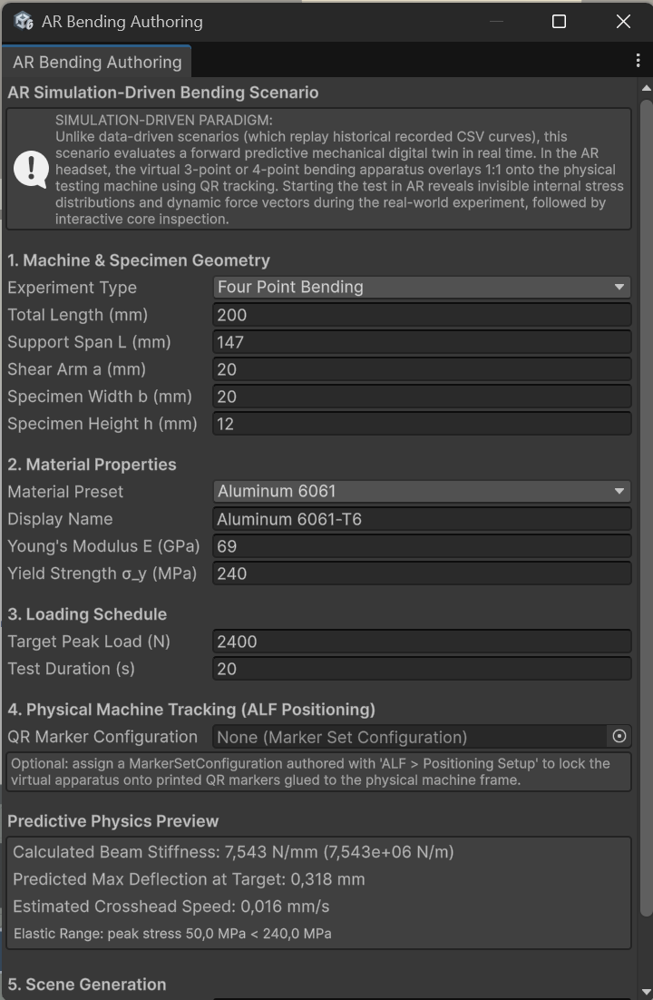

# Build an AR scene for a real testing machine

**Goal:** a digital twin that lies over a real testing machine in AR and shows the stresses inside the specimen while the real test runs.

Learners wear the headset in the lab, next to the testing machine. The virtual apparatus locks onto the real machine through QR codes. When the operator starts the test, a learner presses **Start / Sync**, and the virtual specimen bends along with the real one, showing stress colours and force arrows. After the test, learners look inside the bent specimen with a section plane they can drag along it.

:::caution[Calculated, not measured]
The digital twin calculates what should happen from the values you enter. It doesn't read the real machine's sensors. Enter the real test's values carefully.
:::

## What you need

- The test's values: dimensions, material and loading schedule.
- Printed QR codes on the testing machine's frame, set up with [Positioning Setup](../../positioning/index.md). Without them, the apparatus doesn't lock onto the machine.
- A headset with passthrough (AR).

## Steps

1. Open **ALF > Content Creation > Mesh Deformation > Author AR Simulation Scenario**.
2. Under **1. Machine & Specimen Geometry**, choose three-point or four-point bending and enter the dimensions in millimetres: **Total Length**, **Support Span L**, **Shear Arm a** (four-point only), **Specimen Width b** and **Specimen Height h**.
3. Under **2. Material Properties**, choose a **Material Preset** (Aluminum 6061, Structural Steel, Brass, PMMA), or enter the **Young's Modulus E (GPa)** and **Yield Strength σ_y (MPa)** yourself.
4. Under **3. Loading Schedule**, enter the **Target Peak Load (N)** and the **Test Duration (s)**.
5. Under **4. Physical Machine Tracking**, choose the **QR Marker Configuration** from Positioning Setup.
6. Check the **Predictive Physics Preview**: the beam's stiffness, the expected deflection, the crosshead speed, and whether the load stays in the elastic range. If it says **Yielding Onset**, the specimen would bend permanently; the lab shows when that starts.

   

7. Under **5. Scene Generation**, check the **Output Scene Path** and press **Build AR Simulation Scenario Scene**.
8. Add the new scene to the scene list and [deploy it](../../../deployment/index.md) to the headset.

## In the lab

1. Learners look at the QR codes until the virtual apparatus locks onto the machine.
2. The operator starts the real test, and a learner presses **Start / Sync** at the same moment.
3. After the test, the virtual specimen stays in its final bent shape. Learners switch on the **Cut-away** and drag the **section plane** along the specimen to look inside.

## Good to know

- **Start / Sync must match the machine's start.** If they start at different times, the twin runs ahead or behind.
- **Try it on the headset before the lesson**, with the real machine and the printed codes.
