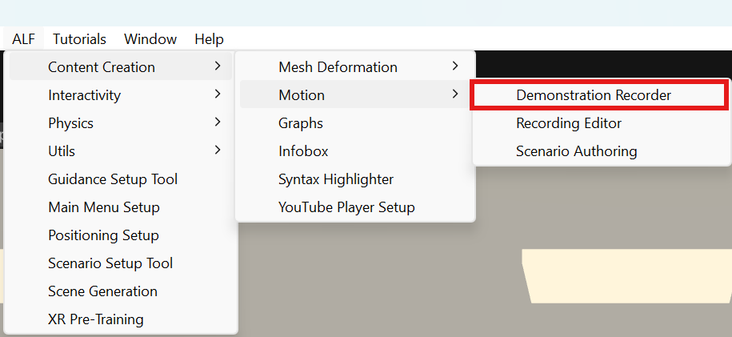

# Record a demonstration

**Goal:** record your hand movements and voice while you operate a machine.

## Set up the scene

1. Open **ALF > Content Creation > Motion > Demonstration Recorder**.

   

2. Under **Step 1: Choose Your Demonstration Target**, choose the **Demonstration Target Mode**:
   - **Virtual Machine**: drag the machine from the **Hierarchy** into **Virtual Machine Object**. Tick **Enable Passthrough** if you want to see your room around it.
   - **Physical Machine**: drag the object that marks the real machine's position into **Physical Anchor Transform**.
3. Under **Step 2: Inject Your Scene Recording Rig**, press **Inject Recording Rig into Scene**.

   This adds the hand-tracking setup and a **recording menu on your wrist**. It replaces any other player setup in the scene, for example one from Scene Generation, so there's only one.

4. Under **Step 3**, open **Verify Headset Settings Before Recording** and go through the checklist.

## Record (with Quest Link)

1. Connect the Quest 3 to the computer with a USB-C cable, or use Air Link.
2. In the headset, open **Quick Settings** and select **Quest Link**.
3. Under **Step 4: Record Your Live Demonstration**, type a **Recording Clip Name**, for example `Start the pump`. Tick **Record voiceover audio with microphone** to record your voice.
4. Press **Play** in Unity.
5. Put on the headset. Look at your **free wrist**: the recording menu appears there.
6. Poke **Start Recording**. After a 3-second countdown, recording starts.
7. Operate the machine naturally and explain each step out loud.
8. Poke **Stop Recording**. The recording is saved, and the menu shows how well your hands were tracked.

You can also start and stop the recording from the tool window with **● Start Recording Session** and **■ Stop Recording**.

## Result

The `.json` and `.wav` files are in `Assets/Use Cases/Recordings`. **Open Project Recordings Folder** under **Step 5** shows them.

Next: [Create the playback for learners](./create-the-playback.md). **Proceed to Scenario Authoring →** takes you there with the same settings.

## Tips for a good recording

- **Keep your hands in front of you**, where the headset cameras can see them. Looking away from your hands interrupts tracking.
- **Move a little slower than usual.** Learners need to follow.
- **Do one task per recording.** Short recordings are easier to watch and repeat.
- **Check the tracking result** on your wrist after stopping. If it's low, record again.

## Good to know

- **Mark a moment by hand.** While recording, type a **Marker Name** in the window and press **Trigger Action Marker**, for example when the machine should react to something it can't detect itself.
- **Remove the setup again** with **Remove Rig from Scene**. **Re-link Anchor & Menu to Rig** refreshes it after you change the machine.
- **Setting up the scene doesn't work in Play mode.** Stop Play mode to inject or remove the rig.
