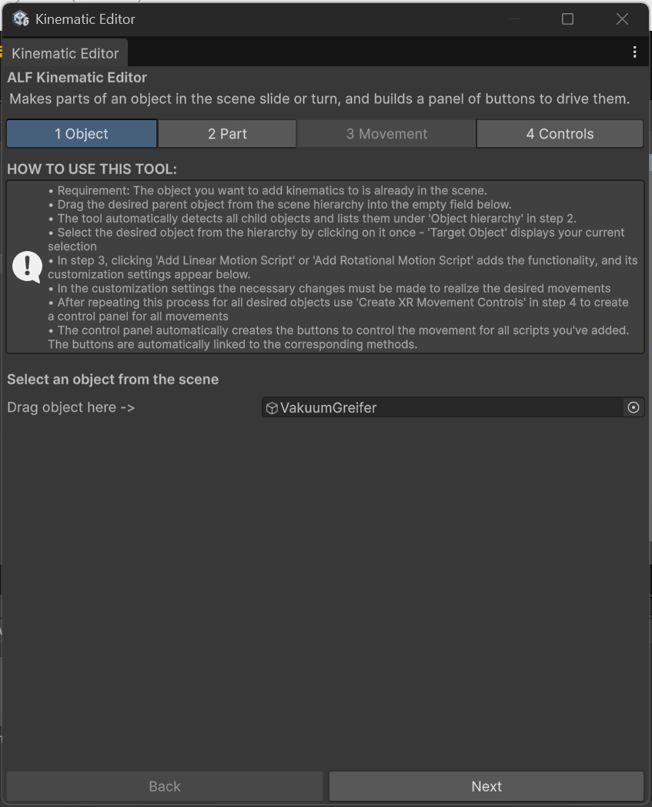

# Before you start

Object Spawner puts a model into your scene and makes it ready for learners, without any setup in the Inspector.

New to Unity? The basic terms (Scene, Hierarchy, Project window, Play mode) are explained in [Button Injection: Before you start](../../button-injection/how-to/before-you-start.md#unity-terms-youll-see).

## What you need

A **model** in your project's **Project window**: a prefab, or an imported 3D file such as an FBX. To use a file from your computer, drag it from your file explorer into the Project window first.

## Object Spawner or Part Palette?

| Use | When |
|---|---|
| **Object Spawner** | The object should be in the room from the start, at a place you choose. |
| [**Part Palette**](../../part-palette/index.md) | Learners should take parts from a board on the wall, as many as they like. |

## Opening the tool

In Unity's top menu, choose **ALF > Interactivity > Object Spawner**. The window works like the other ALF tools:

- **On the left:** every object this tool has placed in the scene. Click one to change it.
- **On the right:** four steps, one at a time.

| Step | What you do there |
|---|---|
| **1 Object** | Choose the model and where it goes, then place it. |
| **2 Position** | Move and turn it. |
| **3 Interaction** | Choose what learners can do with it. |
| **4 Save** | Check the summary, save, or remove objects. |

- **The heading above the steps** tells you what you're working on: `Editing '…'` for an object in the scene, or `New object — not placed yet`.
- **Changes appear immediately.** Every change to a placed object shows in the scene straight away. You only need to save the scene at the end.

:::caution[Not while the scene is playing]
Anything you change in Play mode is lost when you stop. Stop Play mode first.
:::
