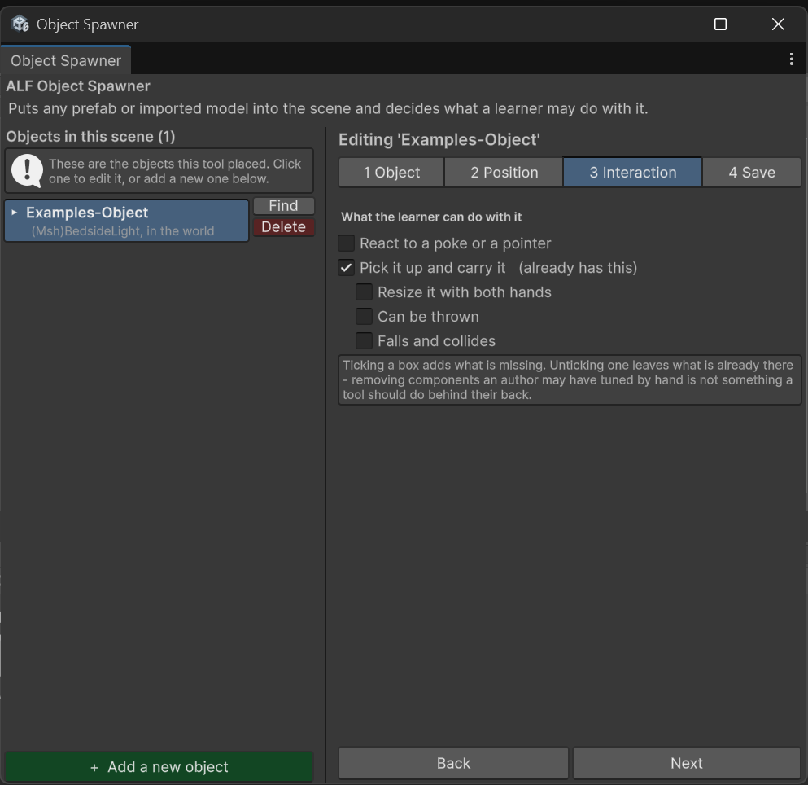
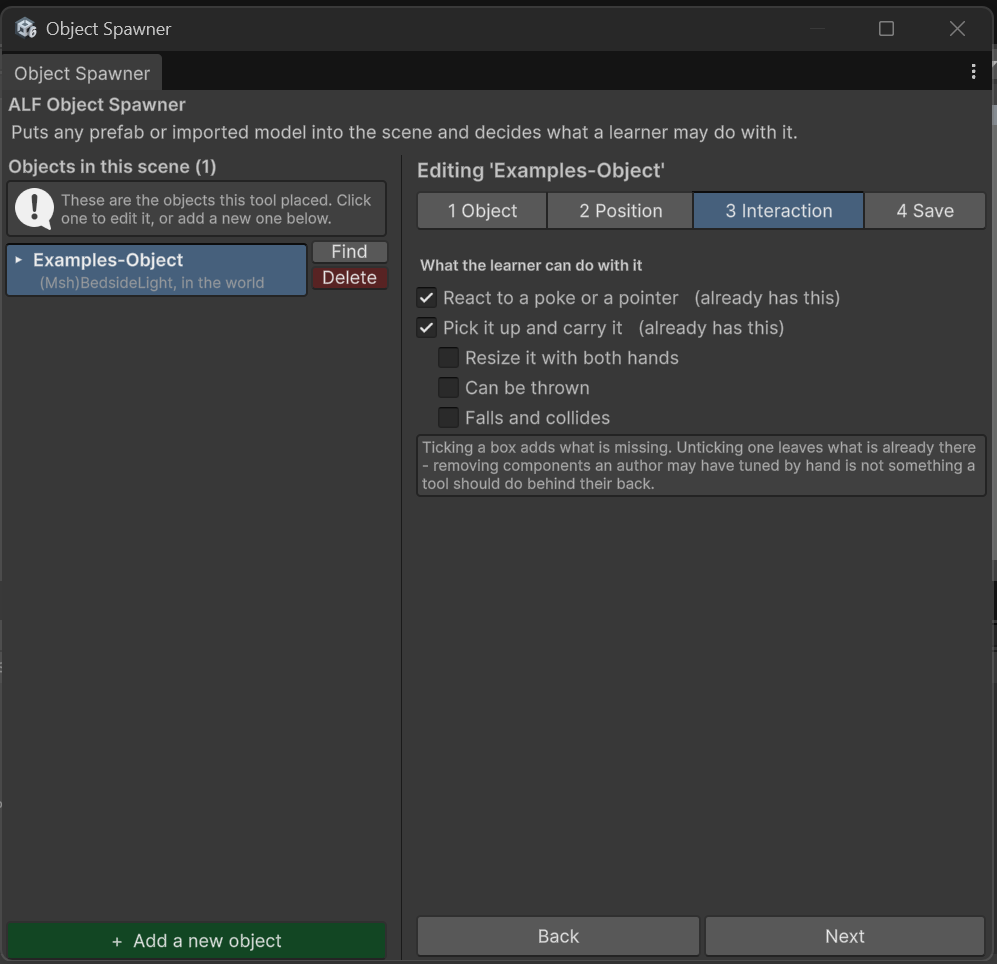

# Choose what learners can do with an object

**Goal:** decide whether learners can poke an object, pick it up, resize it or throw it, and whether it falls.

## Steps

1. Click the object in the list on the left.
2. Open step **3 Interaction**.

   

3. Under **What the learner can do with it**, tick the options you want:

| Option | Learners can… |
|---|---|
| **React to a poke or a pointer** | Touch it or point at it. Use this for objects that act like a button. |
| **Pick it up and carry it** | Grab it and move it around. |
| **Resize it with both hands** | Make it bigger or smaller by holding it with both hands and pulling apart. |
| **Can be thrown** | Throw it: when they let go, it keeps the speed of their hand. |
| **Falls and collides** | When switched on, it falls to the ground and bumps into things. When off, it floats where it's let go. |

The last three options are only available while **Pick it up and carry it** is ticked.

4. Save the scene in step **4 Save**.

## Which options to choose?

| Object | Suggested options |
|---|---|
| A part to look at closely | *Pick it up and carry it*, *Resize it with both hands* |
| A tool to put down on a table | *Pick it up and carry it*, *Falls and collides* |
| Something that acts like a switch | *React to a poke or a pointer* |
| Decoration | Nothing ticked |

## Good to know

- **"(already has this)"** next to an option means the model already comes with that ability. It's kept as it is.
- **Unticking doesn't remove anything.** It only stops the tool adding what's missing. *Resize it with both hands* is the exception: unticking it really does switch resizing off.
- **Poking and picking up together** is allowed, but you'll see a warning. When a learner reaches for the object, only one of the two reacts.

  

- **Throwing and falling:** without *Falls and collides*, a thrown object flies off without coming down.
