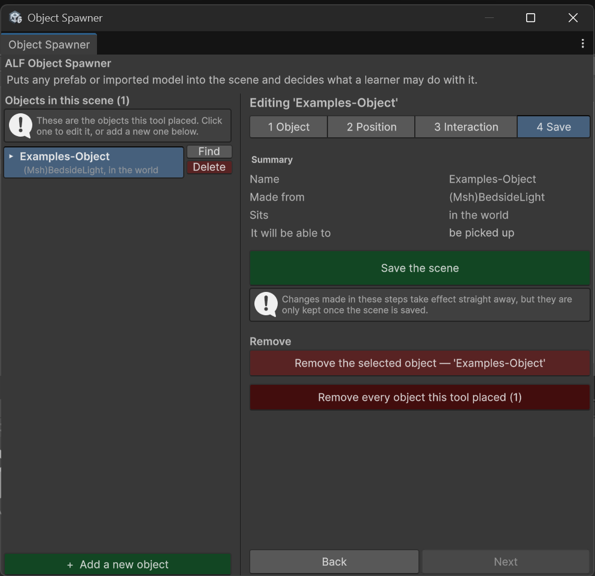

# Edit, rename or remove an object

## Find an object again

Every object this tool placed is in the list on the left, with its name and where it sits.

- **Click a row** to edit that object.
- **Press Find** next to a row to see where it is in the scene.

While an object is selected, every change you make **applies to it straight away**.

## Rename an object

1. Click the object in the list.
2. In step **1 Object**, change the **Name**. It's renamed as you type.

## Check an object's setup

Step **4 Save** shows a **Summary** of the selected object: its name, which model it was made from, where it sits, and what learners can do with it.

## Remove objects

| To remove… | Do this |
|---|---|
| One object | Press **Delete** next to it in the list. |
| The object you're editing | In step **4 Save**, press **Remove the selected object**. The button shows the object's name. |
| Every object this tool placed | In step **4 Save**, press **Remove every object this tool placed**. You'll be asked to confirm. |

Objects placed by other ALF tools are never removed here. The models in your Project window are not deleted either.

After removing, save the scene in step **4 Save**.
