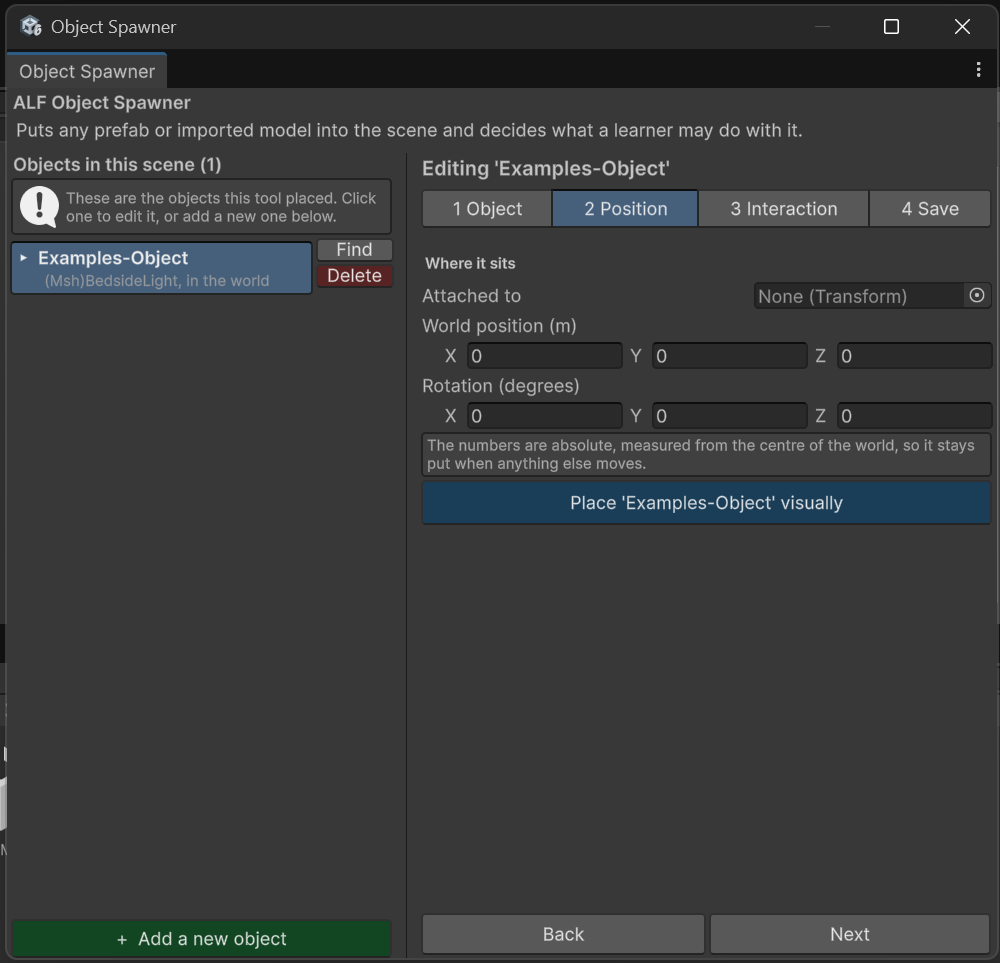

# Move an object

**Goal:** put an object exactly where it should be, or attach it to another object.

## Steps

1. Click the object in the list on the left.
2. Open step **2 Position**.
3. Under **Where it sits**, move it:
   - **Type the position** in metres. The field's label tells you what it's measured from:
     - `World position (m)`: from the centre of the world;
     - `Position on '…' (m)`: from the object it sits on.
   - **Turn it** with the rotation field.
   - **Place it visually:** press **Place '…' visually** to open a small preview window and move it by eye. The numbers follow as you drag.

   

4. Save the scene in step **4 Save**.

## Attach it to another object, or free it

Use the **Attached to** field in step 2:

- **To attach it:** drag the object it should sit on from the Hierarchy into **Attached to**. It then moves with that object.
- **To free it:** clear **Attached to**. It then stands on its own in the world.

The object stays where it is when you change this. Only the numbers change, because they're now measured from somewhere else.

## Good to know

- **You can't attach an object to itself**, or to something inside it.
- **Drag from the Hierarchy**, not the Project window. The Hierarchy holds the objects in your scene.
