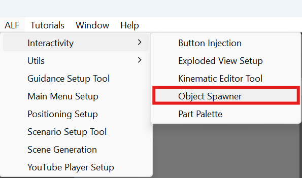
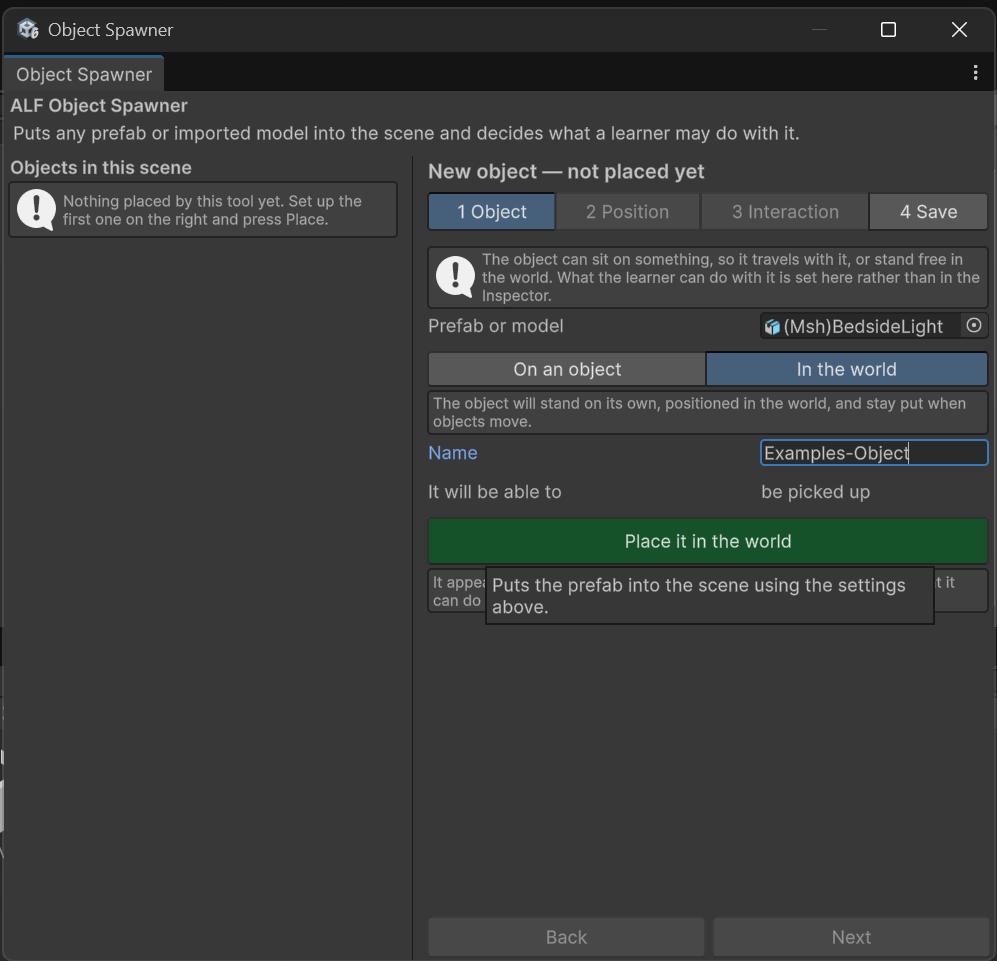

# Put an object in the scene

**Goal:** add a model to your lesson, either standing in the room or sitting on another object.

## Steps

1. Open **ALF > Interactivity > Object Spawner**.

   

2. Under the list on the left, press **+ Add a new object**. The steps are now headed **New object — not placed yet**. In an empty scene, the window starts this way.
3. In step **1 Object**:
   1. Drag the model from the **Project window** into **Prefab or model**.
   2. Choose where it goes:
      - **In the world:** it stands on its own and stays put when other things move.
      - **On an object:** drag that object from the **Hierarchy** into **Object**. The model then moves with it.
   3. Type a **Name**, or leave it empty to name it after the model.
   4. Press **Place it in the world** or **Place it on this object**.

   

4. The object appears at the **centre of its space** (the centre of the world, or of the object it sits on) and is selected, with step **2 Position** open. Move it into place. See [Move an object](./move-an-object.md).
5. In step **3 Interaction**, choose what learners can do with it. See [Choose what learners can do with an object](./choose-what-learners-can-do.md).
6. In step **4 Save**, press **Save the scene**.

## Result

The object is in the scene and listed on the left.

## Good to know

- **The object may be hidden at first,** for example inside the object it sits on, or far from your room. Move it in step 2, or press **Find** next to it in the list.
- **Names are kept unique.** If the name is already in use, a number is added.
- **Interaction settings are copied** from the object selected in the list, so several objects can be set up alike. You can change them in step 3.
- **The tool tells you what a model already has.** If a model can already be picked up or poked, step 1 says so, and that setup is kept.
