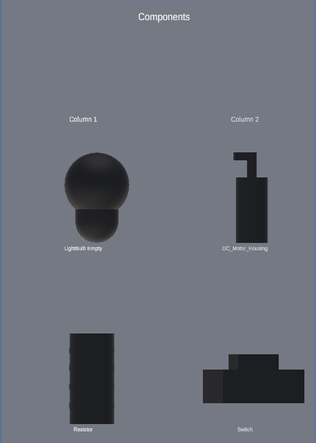
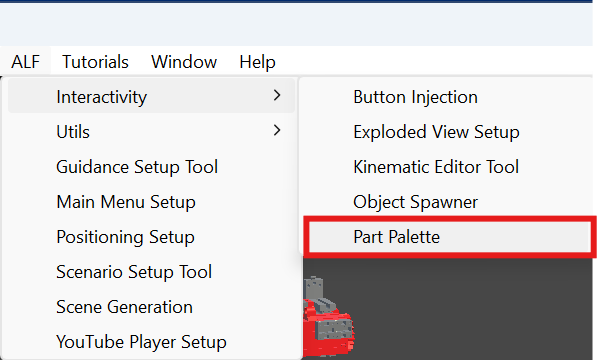

# Before you start

A Part Palette is a board on the wall of your scene with small 3D models of parts on it, like the drawers of item bench. When a learner pokes one, the real part appears floating in front of the board, ready to grab.

## What you need

- **A prefab for each part.** A prefab is a ready-made object saved in your project, such as a resistor model. You'll find prefabs in the **Project** window, usually at the bottom of the Unity editor.
- **Ideas for columns.** Decide how to group the parts: one column per kind of part, one row per variant.

New to Unity? The basic terms (Scene, Hierarchy, Play mode) are explained in [Button Injection: Before you start](../../button-injection/how-to/before-you-start.md#unity-terms-youll-see).

## Two things to know about this tool

**1. The palette is saved as a file in your project.** Unlike the other ALF tools, the list of columns and parts isn't stored in the scene. It's stored in a **configuration asset**, a file in the Project window. That means you can reuse the same palette in several scenes.

**2. In the editor, the board looks empty.** The scene only holds one empty object for the palette. The cells and miniatures are built when the lesson starts. To see the board while setting it up, use the **preview** in step 1, or the placement preview in step 5.

## Opening the tool

In Unity's top menu, choose **ALF > Interactivity > Part Palette**.

The window has five steps:

| Step | What you do there | Available |
|---|---|---|
| **1 Configuration** | Choose the configuration asset, and open the 3D preview. | Always |
| **2 Layout** | Name the palette, add columns, and fill them with parts. | Once there's a configuration asset |
| **3 Appearance** | Set cell size, spacing, captions and the backboard. | Once there's a configuration asset |
| **4 Spawned Parts** | Choose what learners can do with a part once it appears. | Once there's a configuration asset |
| **5 Scene** | Put the board in the scene, move it, or remove it. | Always |

## Which side is the front?

The front of the board is the side its **blue Z arrow** points to in the Scene view. Labels read correctly from there, and spawned parts appear on that side. A new board is placed facing the Scene view camera, so it starts facing you.
