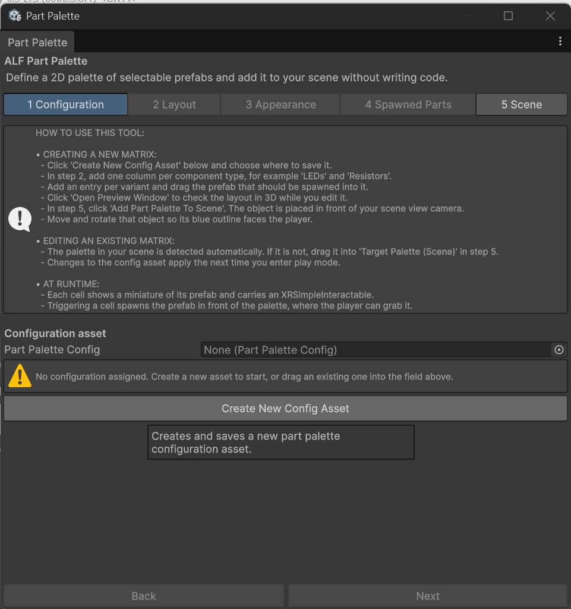
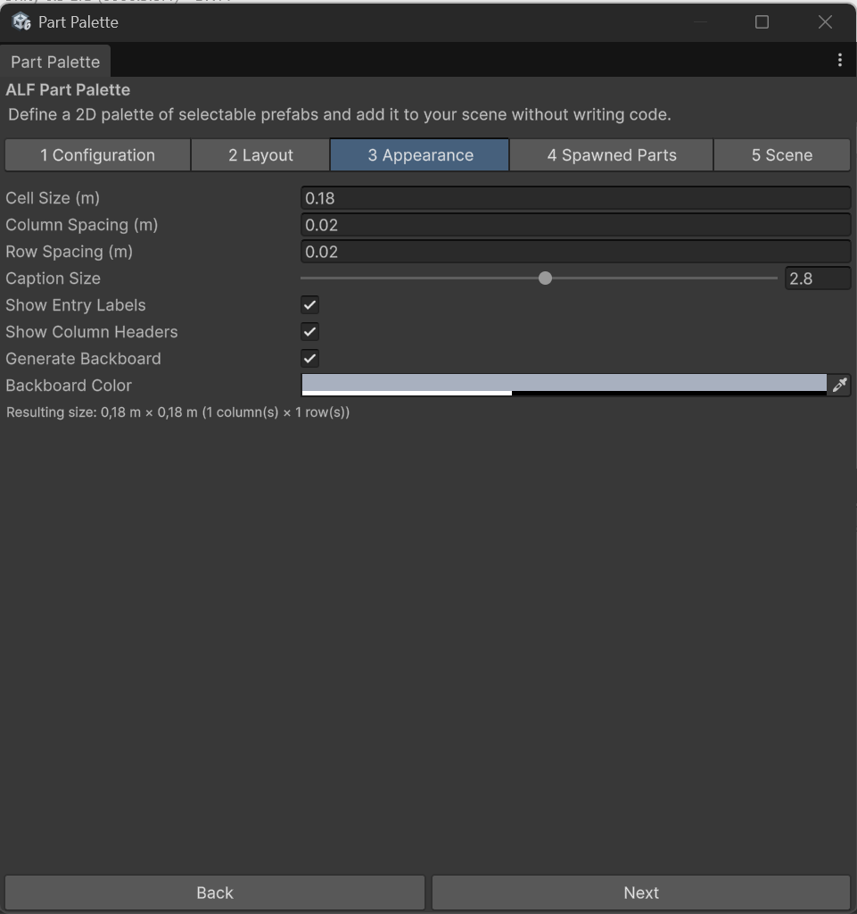
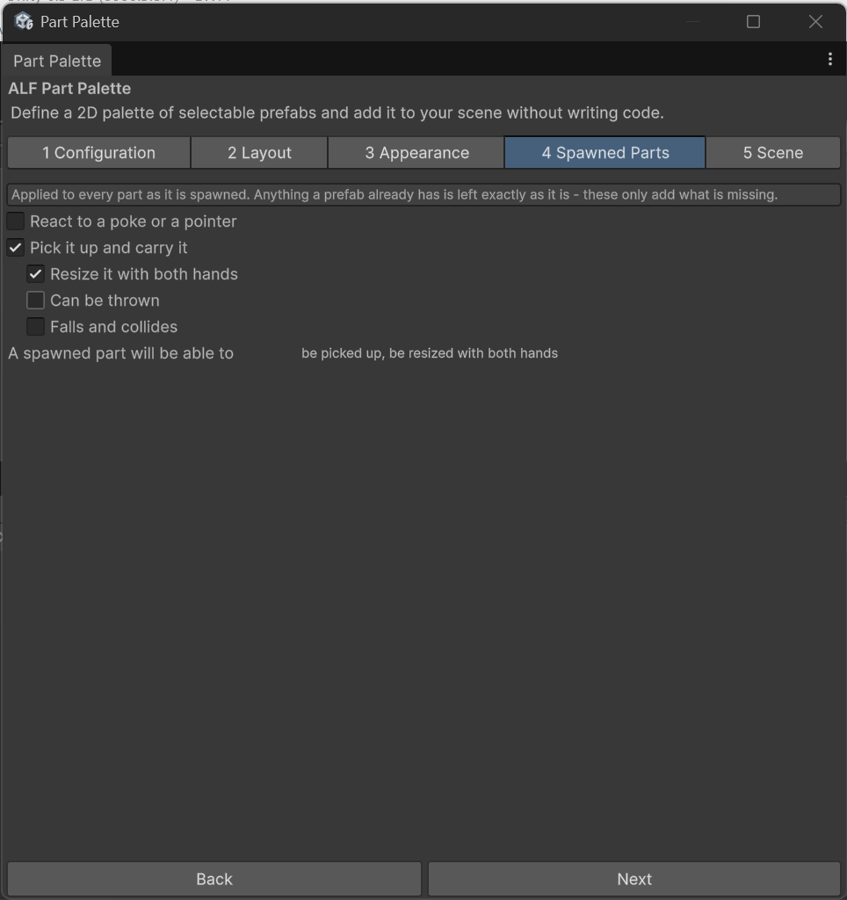
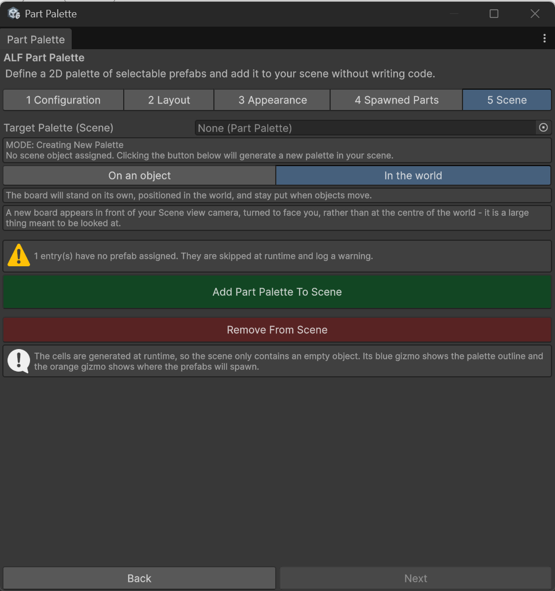

# Create a parts palette

**Goal:** build a board of parts and put it in your scene, from start to finish.

## Steps

1. Open **ALF > Interactivity > Part Palette**.

   

2. **Step 1 Configuration:** choose the configuration asset for this palette. Step 1 explains how to use the tool. To reuse a palette from another scene, choose its existing asset.

   

3. **Step 2 Layout:**
   1. Type a **title** for the palette, for example `Electronics kit`.
   2. Add a column for each kind of part, and add the parts to each column. See [Fill the columns with parts](./fill-the-columns.md).

   

4. **Step 3 Appearance:** adjust the look if you like. The defaults work well. See [Change how the board looks](./change-the-look.md).

   

5. **Step 4 Spawned Parts:** choose what learners can do with a part once it appears. The default lets them grab it, and resize it with two hands. See [Choose what learners can do with a part](./spawned-parts.md).

   

6. **Step 5 Scene:** press **Add to Scene**. The board appears in front of the Scene view camera, facing you.

   

7. Move the board to where it should hang. See [Place the board](./place-the-board.md).
8. Save the scene with **Ctrl+S**.

## Check it

- **Before playing:** press **Open Preview Window** in step 1 to look at the board in 3D. You can orbit around it.
- **In Play mode:** the board is built, and poking a cell makes the real part appear in front of it.

## Good to know

- **Every cell needs a prefab.** Step 2 shows how many parts in each column are still missing one, and step 5 repeats the warning next to **Add to Scene**.
- **Changes you make later** appear the next time you press Play. See [Update or remove a palette](./update-or-remove.md).
