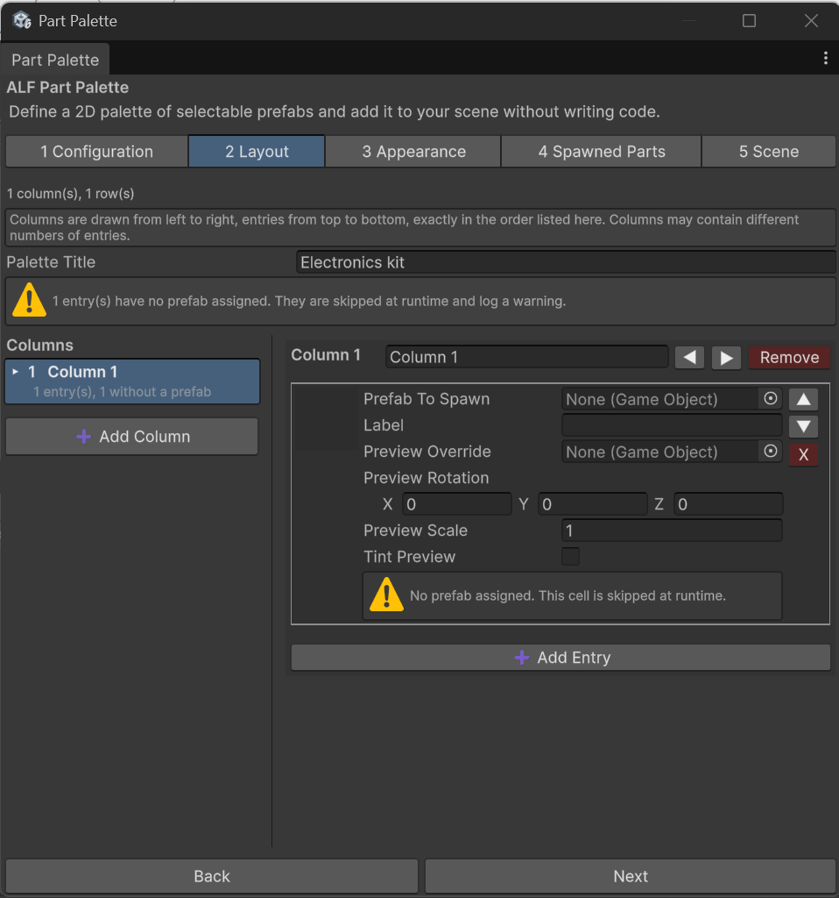

# Fill the columns with parts

**Goal:** add columns to the palette, put parts in them, and arrange them in the right order.

## How the layout step works

Step **2 Layout** shows **one column at a time**:

- **On the left:** a list of all columns. Each row shows the column's label, how many parts it has, and how many of them still have no prefab.
- **On the right:** the parts of the column you selected, at full size.

Click a column in the list to edit its parts.

## Add a column

1. Open step **2 Layout**.
2. Add a column, and give it a **label**, for example `Resistors`.

## Add parts to a column

1. Select the column in the list.
2. Add an entry for each part, one row per variant.
3. For each entry, drag the part's **prefab** from the **Project** window into its prefab field.

The board shows a small 3D copy of each prefab in its cell.

## Change the order of columns

Select a column, then use **◀** and **▶** to move it left or right. The selection moves with it.

## Remove a column

Select it and remove it. The column that takes its place is selected next.

## Good to know

- **Keep an eye on missing prefabs.** A column whose list row shows missing prefabs has cells that won't spawn anything.
- **The miniatures are just pictures.** They're copies of the part's shape only, so they can't fall, collide, or do anything a real part does.
- **Animated characters** and other skinned models are shown in their default pose.
