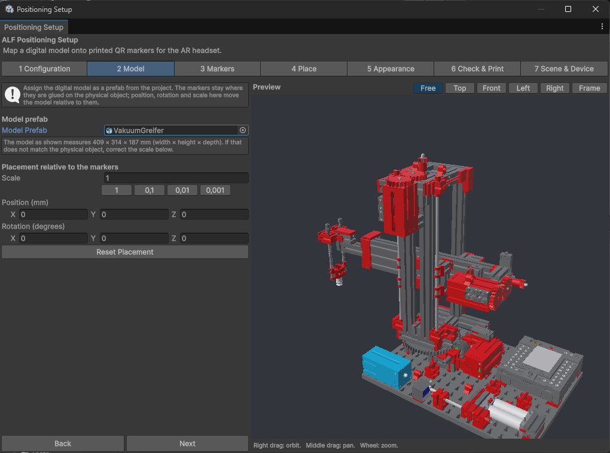

# Add the model

**Goal:** add the 3D model of the real object, and make sure it has the right size.

## Steps

1. Open step **2 Model**.
2. Drag the model from the **Project window** into **Model Prefab**. It appears in the preview.
3. Read the size the tool reports: *The model as shown measures … × … × … mm (width × height × depth).*

   

4. Measure the real object. If the sizes don't match, fix the **Scale**:

   | The model was made in… | Scale |
   |---|---|
   | Millimetres (sizes 1000× too big) | `0.001` |
   | Centimetres (sizes 100× too big) | `0.01` |
   | Metres (sizes correct) | `1` |

   The buttons next to **Scale** set these values for you. Check the reported size again afterwards.
5. Press **Next**.

## Position and rotation

**Position (mm)** and **Rotation (degrees)** move the model relative to the QR codes. You usually don't need them now: leave them at zero and place the codes in step 4. **Reset Placement** sets them back.

## Good to know

- **Use the model from the Project window,** not from the Hierarchy. Objects in the scene aren't accepted here.
- **The size must be right.** If the model is too big or too small, it can't line up with the real object, however carefully the codes are placed.
