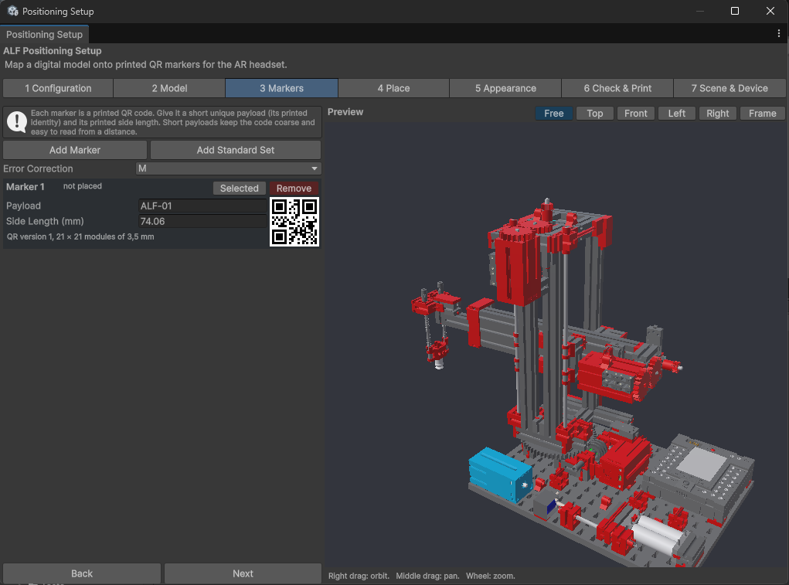

# Add the QR codes

**Goal:** create the QR codes you'll print and stick on the real object.

## Steps

1. Open step **3 Markers**.
2. Add codes in one of two ways:
   - **Add Standard Set:** adds eight ready-made codes, **ALF-01** to **ALF-08**, each 120 mm wide. The easiest choice.
   - **Add Marker:** adds one code at a time.
3. Remove the codes you don't need with **Remove**. **Two to four codes** on one flat face are a good start.

   

4. Press **Next**.

## Settings for each code

| Field | What it means |
|---|---|
| **Payload** | The text inside the code, its "name". Every code needs a different one. Keep it short. |
| **Side Length (mm)** | How big the printed code is, without its white border. **100 to 150 mm** works best. |

Under each code you can see how the code is built, for example *QR version 1, 21 × 21 modules*.

**Error Correction** applies to all codes: how much of a code can be damaged and still be read. **M** is the usual choice.

## Good to know

- **Bigger codes are found from further away.** Small codes, down to 15 mm, are allowed but have to be looked at from close up. For example, 80 mm codes were read at about 50 cm.
- **Short payloads make simpler codes** that are easier to read from a distance.
- **More codes give a steadier result,** as long as they all fit on one flat face.
