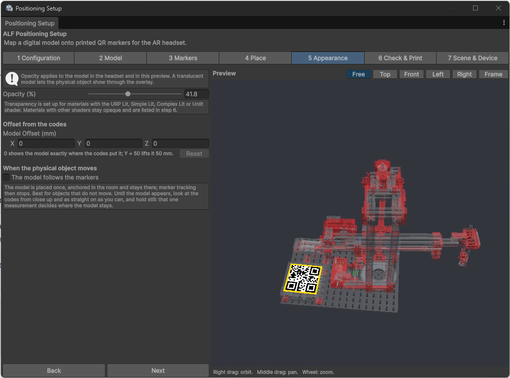

# Set transparency and movement

**Goal:** decide how see-through the model is, fine-tune where it sits, and whether it follows the real object when it moves.

All of this is in step **5 Appearance**.

## Make the model see-through

Set **Opacity (%)**: `100` is solid, lower values let the real object show through. Around `50` is a good start for an overlay on a real machine.

The preview shows the result straight away.

## Shift the model a little

If the model sits slightly off the real object, use **Model Offset (mm)** to shift it. The codes stay where they are; only the model moves.

- In the **Front** view, **X** points right, **Y** up and **Z** away from you.
- `0` shows the model exactly where the codes put it. **Y = 50** lifts it 50 mm.
- **Reset** sets it back to 0.

## Does the real object move?

| The real object… | Setting | What happens |
|---|---|---|
| **Stays in place**, for example a machine on the floor | **The model follows the markers** off | The model is placed once and stays there. The headset stops looking for codes, which saves battery. |
| **Is picked up, turned or pushed around** | **The model follows the markers** on | The model moves with the object while a code is in view, and stays at its last place otherwise. |

:::tip[For objects that stay in place]
When the lesson starts, look at the codes **from close up, as straight on as you can, and hold still** until the model appears. That one look decides where the model stays.
:::

## Good to know

- **Following costs battery and speed,** and fast movements trail slightly behind. Use it only for objects that really move.
- **Some materials can't be made see-through.** If parts of the model stay solid, step 6 lists them. Ask whoever prepared the model.
