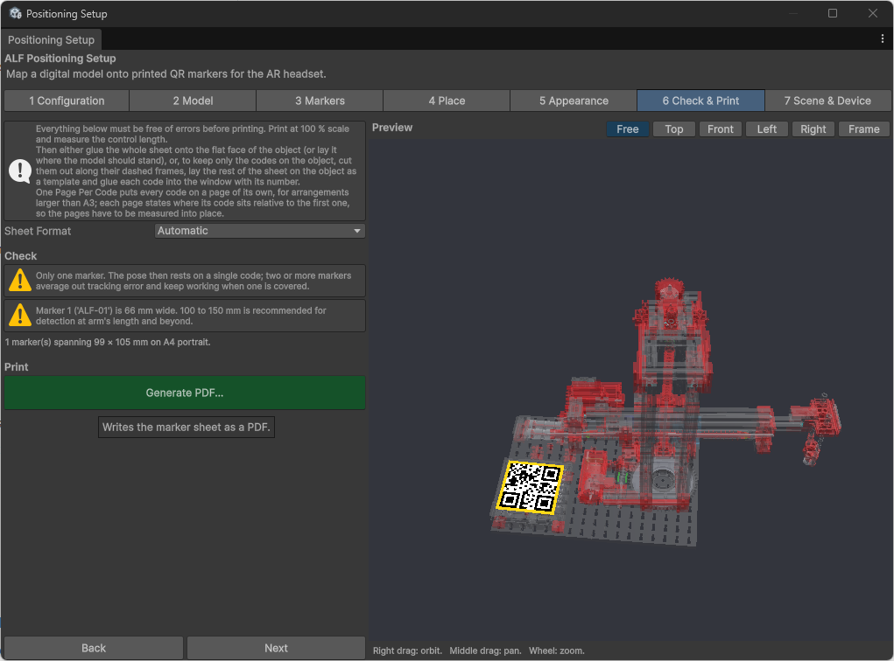

# Check and print the QR codes

**Goal:** print the codes and stick them on the real object, exactly where you placed them in the tool.

## Steps

1. Open step **6 Check & Print**.
2. Under **Check**, read the messages. Errors must be fixed before printing. When everything is fine, it says **No problems found**.
3. Choose the **Sheet Format**:
   - **Automatic:** puts all codes on one A4 or A3 sheet. Use this whenever it fits.
   - **One Page Per Code:** one code per page, for arrangements larger than A3.

   

4. Press **Generate PDF...** and save the file.
5. Press **Open PDF**, or **Show in Folder** to find the file.
6. **Print at 100 %.** In the print dialog, switch off "fit to page" or any scaling.
7. **Measure the control length** printed on the sheet. If it doesn't match exactly, the printer scaled the sheet. Print again with scaling switched off.

## Stick the codes on the real object

Choose one of two ways:

- **The whole sheet:** glue the entire sheet onto the flat face of the object, or lay it where the object should stand.
- **Only the codes:** cut out each code along its dashed frame. Lay the rest of the sheet on the object as a template, and glue each code into the window with its number. Then remove the template.

**One Page Per Code:** each page says where its code sits relative to the first code. Measure carefully to put the pages in the right place.

## Good to know

- **The sheet keeps the codes in the right place.** That's why it matters to print at exactly 100 % and to keep the sheet flat.
- **Good light helps.** The headset reads the codes better in a well-lit room, and without reflections on the paper.
- **Changed the codes?** Generate and print the PDF again. An old printout won't match.
