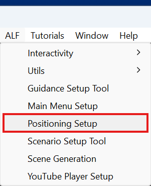
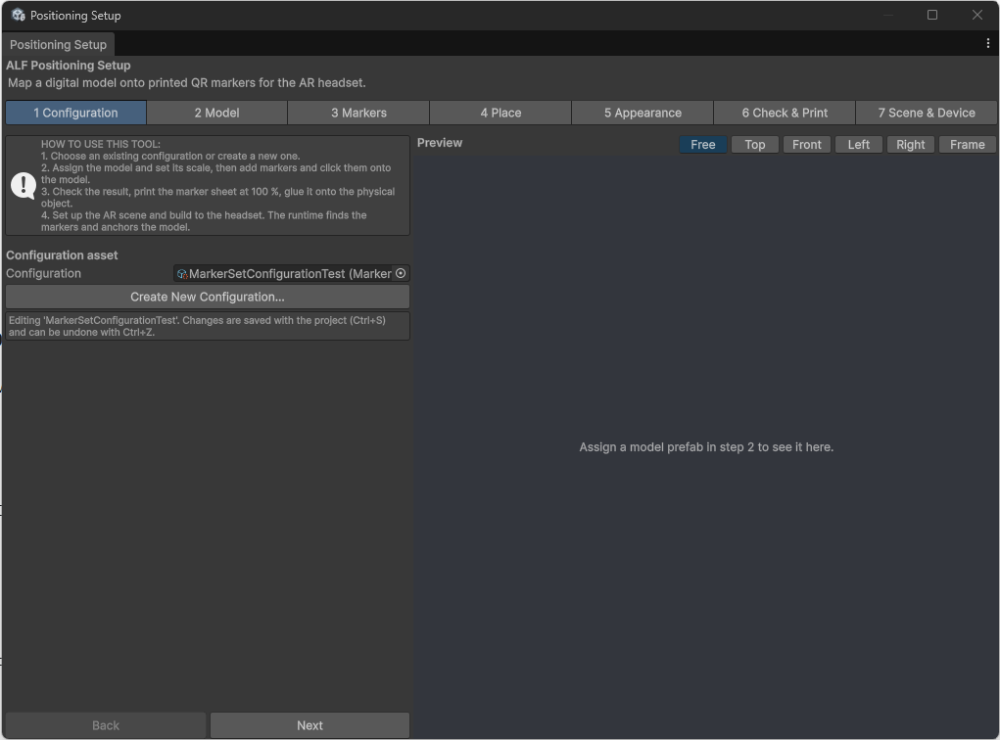

# Create a configuration

**Goal:** create the file that stores everything about one real object: its model, its QR codes and how they're printed.

## Steps

1. Open your **AR** lesson scene.
2. Open **ALF > Positioning Setup**. Step **1 Configuration** is open.

   

3. Press **Create New Configuration...**.
4. Choose a name, for example `Pump positioning`, and save it. By default, it goes in `Assets/ALF/Positioning/Configurations`.
5. The box below says **Editing** followed by your configuration's name.

   

6. Press **Next**.

## To continue an existing configuration

Drag it from the Project window into **Configuration** instead of creating a new one.

## Project settings

If step 1 shows a warning under **Project settings**, the project isn't ready for QR codes yet. Press **Open Project Status** to see what's missing. If you're not sure how to fix it, ask whoever maintains the project.

## Good to know

- **One configuration per real object.** If a lesson uses two real machines, create two configurations.
