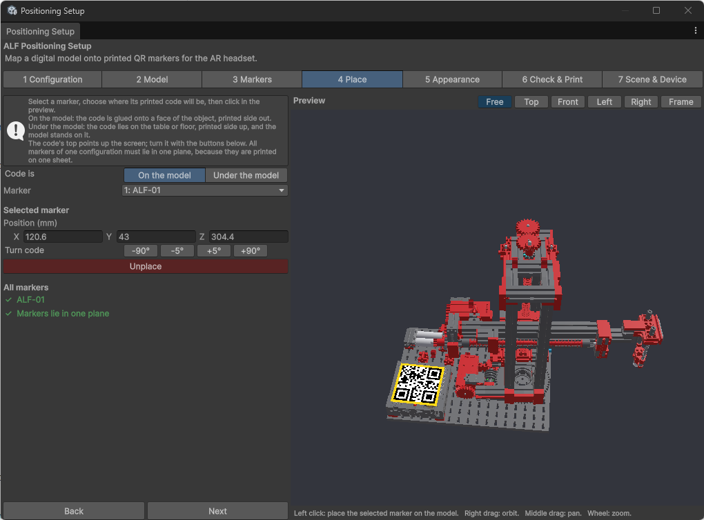

# Place the QR codes on the model

**Goal:** mark where each printed code will be on the real object.

## First, choose where the codes go

Under **Code is**, choose one:

| Option | The printed code… | Good for |
|---|---|---|
| **On the model** | Is glued onto a face of the object, printed side out. | Objects with a large flat face. |
| **Under the model** | Lies on the table or floor, printed side up, with the object standing on it. | Objects without a flat face, or that you can't stick anything on. |

## Steps

1. Open step **4 Place**.
2. Choose **On the model** or **Under the model**.
3. Choose a code in the **Marker** list.
4. **Left-click** in the preview where the code should be: on a face of the model, or on the floor.
   For **Under the model**, you can also press **Centre Under the Model**.
5. Turn the code if needed with the **Turn code** buttons (**-90°**, **-5°**, **+5°**, **+90°**). The top of the code points up the screen.

   

6. Repeat for every code.
7. Check under **All markers** that the tool says **Markers lie in one plane**.
8. Press **Next**.

## Adjust a code

With a code selected:

- **Position (mm)** moves it precisely.
- **Turn code** turns it.
- **Unplace** takes it off the model. It stays in the list, so you can place it again.

## Good to know

- **All codes must lie on one flat surface,** because they're printed on one sheet. If they don't, the tool says *Markers are not in one plane* and won't print.
- **Remember how each code is turned.** On the real object, each code must face the same way as in the preview. The printed sheet helps: it keeps all codes in the right position and direction.
