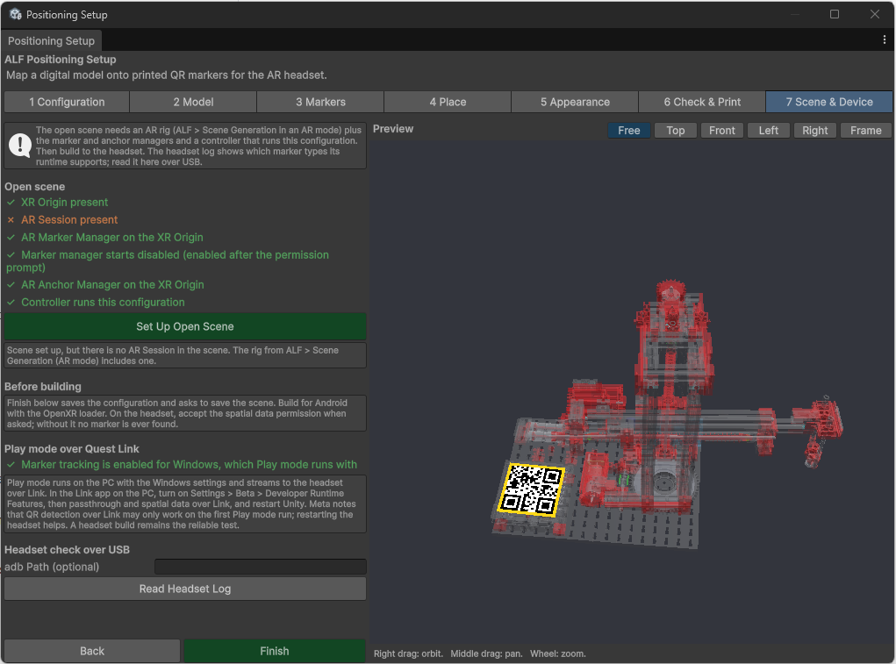

# Set up the scene and test on the headset

**Goal:** connect your configuration to the lesson scene, and try it on the headset.

## Set up the scene

1. Open your **AR** lesson scene.
2. In the tool, open step **7 Scene & Device**.
3. Press **Set Up Open Scene**. The tool adds everything the scene needs to find the codes.
4. Check the lines under **Open scene**. They should all show **✓**. The button now says **Scene is set up**.

   

5. Press **Finish**. The tool saves the configuration and asks you to save the scene.

If **Finish** lists things that are still open, fix them, or choose **Close Anyway** to save the setup as it is.

## Test on the headset

The reliable test is the app built onto the headset. Building is usually done by whoever maintains the project.

On the headset:

1. Start the app and open the lesson.
2. When the headset asks for permission to use **spatial data**, accept. Without it, no codes are ever found.
3. Look at the codes from close up and as straight on as you can.
4. The model appears on the real object.

## Quick test with Play mode (Quest Link)

You can also press **Play** in Unity while a Quest headset is connected to the PC with Quest Link. This needs a few settings:

- **Under Play mode over Quest Link,** the tool must say *Marker tracking is enabled for Windows*. If not, turn it on in **ALF > Utils > Project Status**.
- **In the Meta Quest Link app on the PC,** turn on **Settings > Beta > Developer Runtime Features**, then passthrough and spatial data over Link. Restart Unity afterwards.

QR codes over Link may only be found on the first Play mode run. Restarting the headset helps.

## Check the headset (advanced)

With the headset connected by USB, **Read Headset Log** shows what the headset reports, including whether it supports QR codes at all. This is mainly useful for whoever maintains the project.
