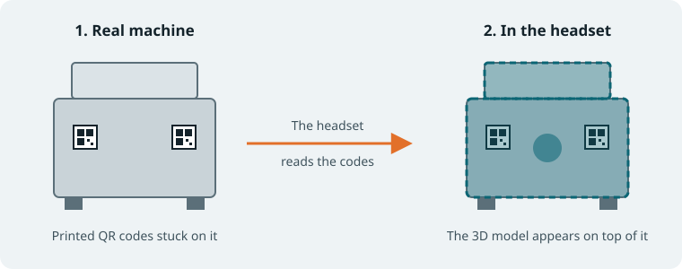

# Positioning Setup

**Menu:** ALF > Positioning Setup

For **AR lessons only.** Lines up your 3D model with a **real object** in the room, for example a digital overlay on a real machine. You stick printed **QR codes** on the object (or lay them under it). The headset finds the codes and shows the model exactly in the right place.

## Quick start

1. Make an **AR** lesson scene with [Scene Generation](../scene-generation/index.md).
2. Open **ALF > Positioning Setup** and work through the seven steps:
   1. **Configuration:** create a configuration.
   2. **Model:** add the 3D model and check its size.
   3. **Markers:** add the QR codes.
   4. **Place:** click where each code goes on the model.
   5. **Appearance:** set transparency, and whether the model follows the object.
   6. **Check & Print:** print the codes at 100 % and stick them on the real object.
   7. **Scene & Device:** set up the scene, then test on the headset.
3. Press **Finish**.

## Guides

1. [Before you start](./how-to/before-you-start.md)
2. [Create a configuration](./how-to/create-a-configuration.md)
3. [Add the model](./how-to/add-the-model.md)
4. [Add the QR codes](./how-to/add-the-qr-codes.md)
5. [Place the QR codes on the model](./how-to/place-the-qr-codes.md)
6. [Set transparency and movement](./how-to/appearance-and-movement.md)
7. [Check and print the QR codes](./how-to/check-and-print.md)
8. [Set up the scene and test on the headset](./how-to/set-up-the-scene-and-headset.md)
9. [Troubleshooting](./how-to/troubleshooting.md)
