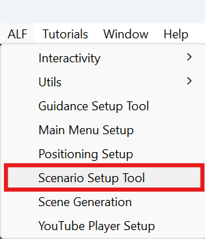

# Create a scenario

**Goal:** build a lesson with several steps, from start to finish.

## Steps

### 1 System

1. Open **ALF > Scenario Setup Tool**.

   

2. Under **System Target**, leave **Order Manager** and **Guidance Manager** empty. The box below says **MODE: Creating a new setup.**

   

3. Under **Sequence Length**, set **Number of Steps**, for example `5`, and press **Update Count**. You can have up to 20 steps.

### 2 Steps

4. Open tab **2 Steps**. The steps are listed on the left.

   

5. Click a step, then fill in its two halves with the tabs above it:
   - **Environment & Flow:** [show or hide objects](./show-or-hide-objects.md) and [choose how the step finishes](./choose-how-a-step-finishes.md).
   - **Guidance & UI:** [write the instructions](./write-the-instructions.md) and [place the panel](./place-the-instructions.md).
6. Repeat for every step.

### 3 Generate

7. Open tab **3 Generate**.
8. If a box lists problems, fix them first. Each one names the step it's in.
9. Press **Spawn New Scenario System**.
10. Save the scene with **Ctrl+S**.

## Result

The scenario is built into the scene. Press **Play** to try the lesson from the first step.

## Good to know

- **The list shows what each step does.** The second line of each row gives a short summary. A **⚠** means the step has a problem.
- **Both halves belong to the same step.** Switching between **Environment & Flow** and **Guidance & UI** doesn't change which step you're editing.
- **Generating again is safe.** After you change something, press the button again. It now says **Update Existing Scenario System**.
