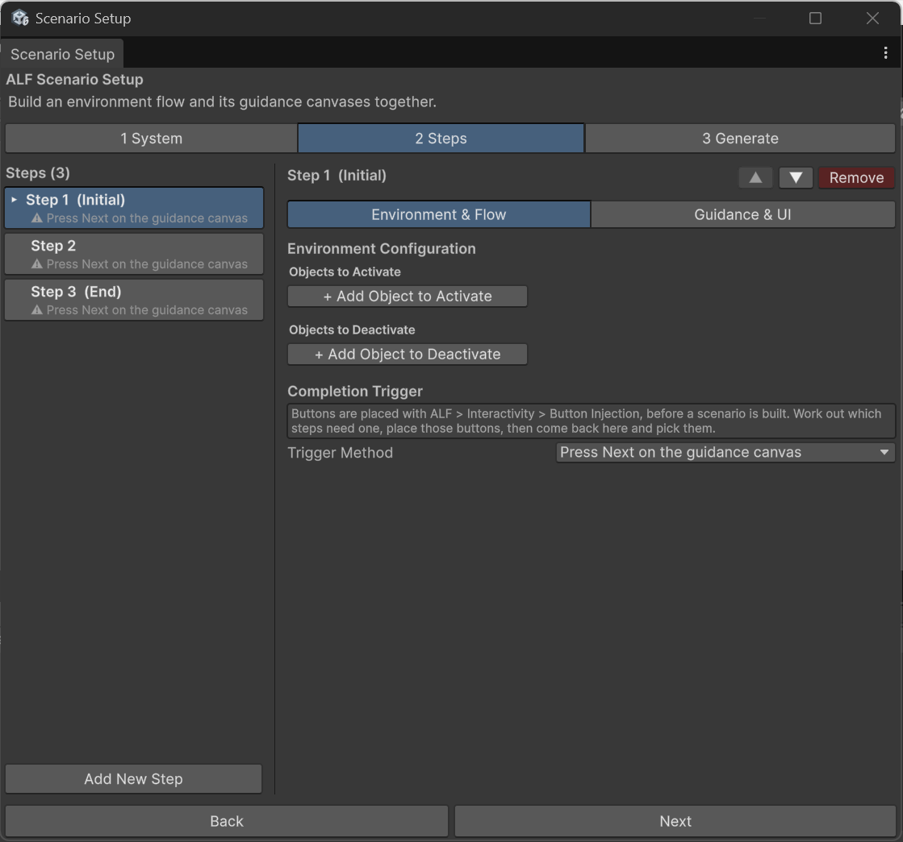

# Show or hide objects during a step

**Goal:** make objects appear or disappear when a step starts, for example showing a tool the learner needs, or hiding a cover so they can see inside a machine.

## Steps

1. In tab **2 Steps**, click the step in the list.
2. Switch to **Environment & Flow**.

   

3. Under **Environment Configuration**:
   - To **show** objects, press **+ Add Object to Activate**, then drag the object from the Hierarchy into the new slot.
   - To **hide** objects, press **+ Add Object to Deactivate**, then drag the object into the new slot.
4. To remove an entry, press **X** next to it.
5. Generate the scenario in tab **3 Generate**.

## How it behaves

- **Changes happen when the step starts.**
- **Changes last** until a later step changes them again. An object shown in step 2 is still there in step 5, unless you hide it.
- **Going back undoes them.** When the learner presses **Previous**, the room goes back to how it was at that step.

## Tips

- **Objects that should appear later** must be in the scene from the start. Switch them off in the Inspector (untick the box next to their name) and show them in the right step.
- **Hide a whole group at once** by hiding the object that contains it in the Hierarchy.
- **Exploded views** add an entry here by themselves when you open them at a lesson step. You may see it in the list. Leave it there.
