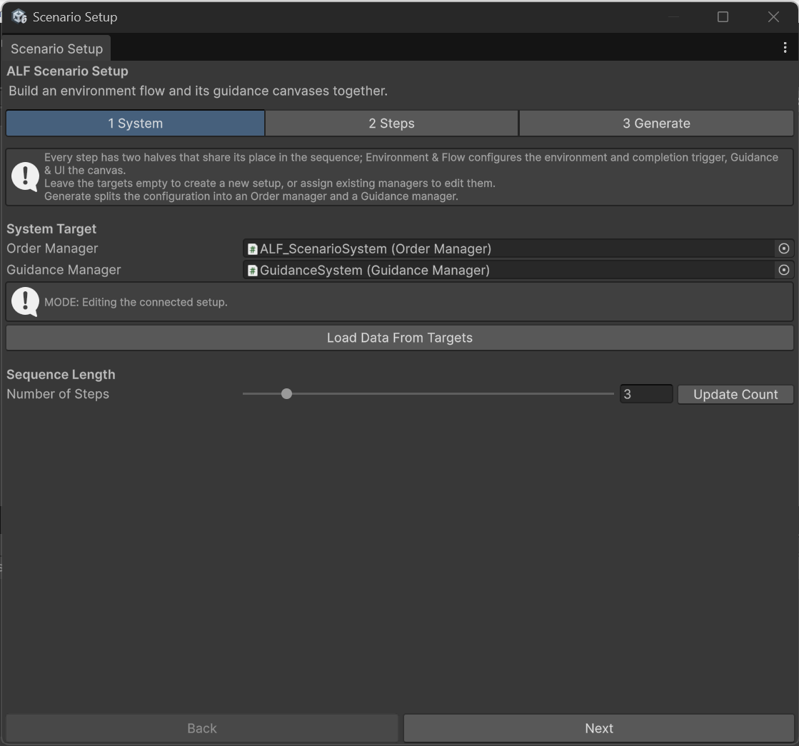
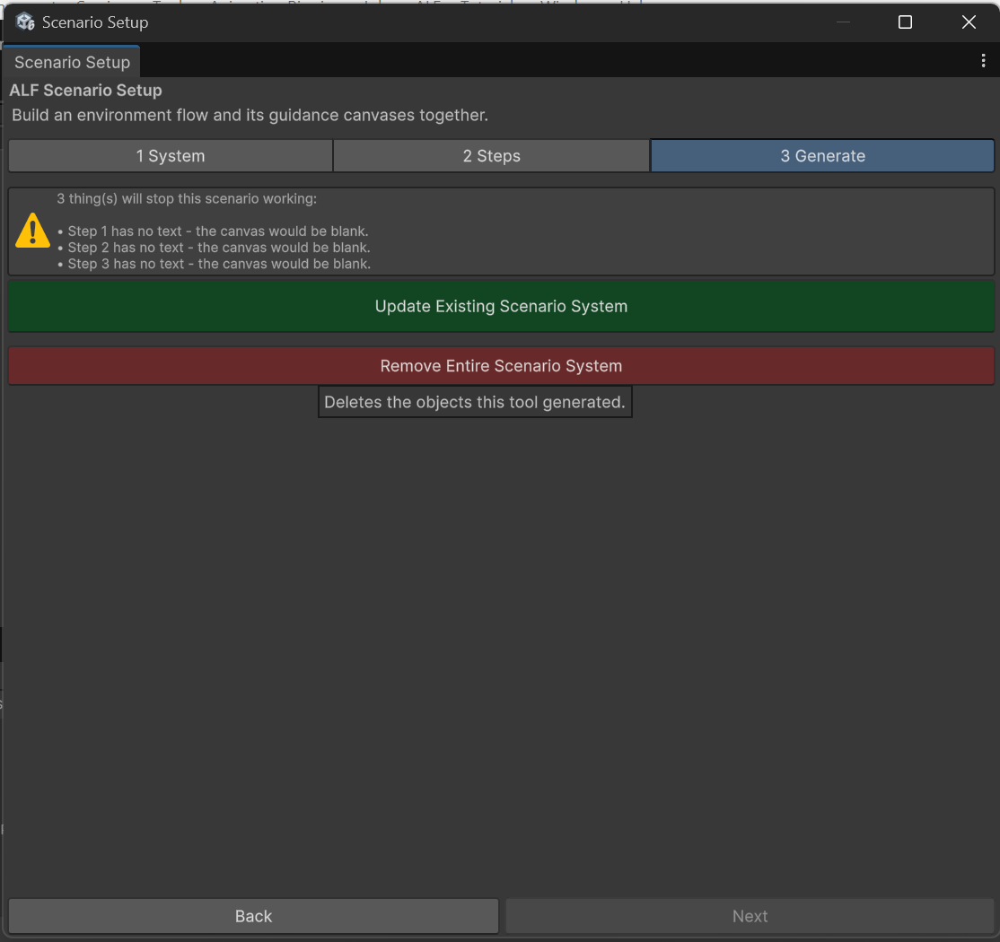

# Update or remove a scenario

## Change an existing scenario

1. Open the lesson's scene.
2. Open **ALF > Scenario Setup Tool**. It finds the scenario in the scene and loads its steps. Tab **1 System** shows **MODE: Editing the connected setup.**

   

3. Make your changes in tab **2 Steps**.
4. In tab **3 Generate**, press **Update Existing Scenario System**.
5. Save the scene with **Ctrl+S**.

## Start again from what's in the scene

If your changes in the tool went wrong, press **Load Data From Targets** in tab **1 System**. It throws away the changes you haven't generated yet, and reloads the steps from the scene.

## Remove the scenario

1. In tab **3 Generate**, press **Remove Entire Scenario System**.

   

2. Confirm with **Yes, Remove**.
3. Save the scene with **Ctrl+S**.

This deletes everything the tool built: the steps, the instruction panels, and the places learners had to reach.

## Good to know

- **Your own objects are kept.** Objects you placed with other tools, and objects you used as a **Spawn Point Target** or **Attachment Target**, are not deleted.
- **Undo works.** If you removed the scenario by mistake, press **Ctrl+Z** straight away.
