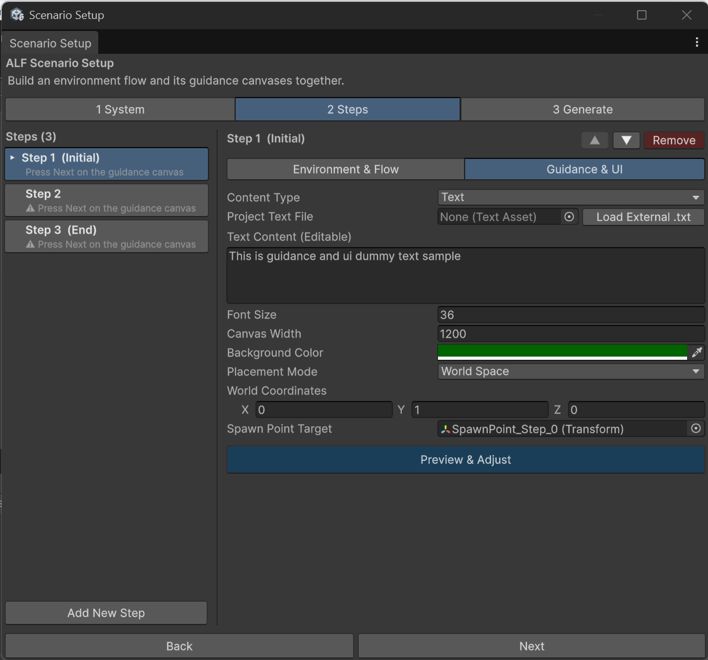

# Write the instructions for a step

**Goal:** decide what the learner reads or watches during a step: text, an image or a video.

## Steps

1. In tab **2 Steps**, click the step in the list.
2. Switch to **Guidance & UI**.

   

3. Choose the **Content Type**, then fill in its fields as below.
4. Choose the panel's **Background Color**. The colour picker also sets how see-through it is.

When you're done with all steps, generate the scenario in tab **3 Generate**.

## Text

| Field | What to do |
|---|---|
| **Text Content (Editable)** | Type the instructions. |
| **Project Text File** | Optional: use a `.txt` file that's already in the project. If **Text Content (Editable)** also has text, that text is used instead. |
| **Load External .txt** | Copies the text of a `.txt` file from your computer into the text field, where you can edit it. |
| **Font Size** | How big the text is on this panel. |
| **Canvas Width** | How wide the panel is. Wider panels need fewer lines. |

You can format text with tags, for example `<b>bold</b>`, `<i>italic</i>` or `<color=red>red</color>`.

## Image

| Field | What to do |
|---|---|
| **Source Image** | Drag a picture from the Project window. |
| **Canvas Width** | How wide the panel is. |

To use a picture from your computer, first drag it from your file explorer into the **Project window** to import it.

## Video

| Field | What to do |
|---|---|
| **YouTube URL** | Paste the video's link. Normal, share, shorts and live links all work. |
| **Video Size** | **Small**, **Default**, **Big** or **Large**, or **Custom** with your own **Custom Multiplier**. |

When the link is read correctly, the tool shows **Video ID detected:** followed by the video's code. If it says **No video ID could be read from this URL**, copy the link again from YouTube.

:::note[Videos need an internet connection]
The video plays from YouTube, so the headset must be online during the lesson.
:::

## Good to know

- **Keep each step short.** One instruction per step is easier to follow than a long text.
- **A step without content is listed as a problem** in tab **3 Generate**, because its panel would be blank.
