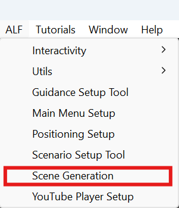
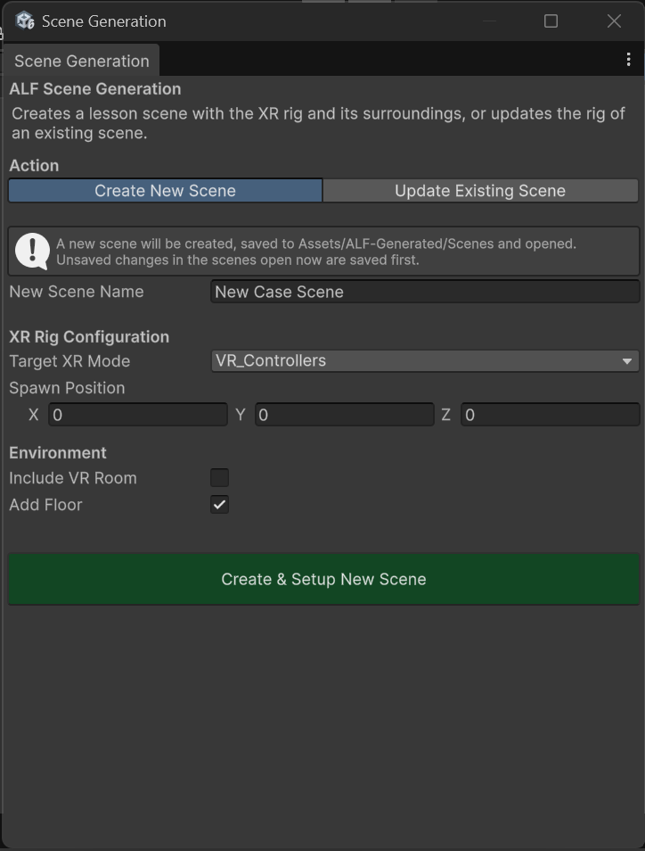

# Create a lesson scene

**Goal:** make a new, empty scene for a lesson, with the player set up and ready to go.

## Steps

1. Open **ALF > Scene Generation**.

   

2. At the top, choose **Create New Scene**.

   

3. Type a **New Scene Name**, for example `Pump maintenance`.
4. Under **XR Rig Configuration**:
   1. Choose the **Target XR Mode**. See [The five player setups](./before-you-start.md#the-five-player-setups).
   2. Leave **Spawn Position** at `0, 0, 0` unless the learner should start somewhere else. The numbers are in metres.
5. Under **Environment**:
   - **VR:** tick **Include VR Room** for a ready-made room, and pick it in **VR Room Prefab**.
   - **VR or AR:** leave **Add Floor** ticked so the learner has ground to stand on.
6. Press **Create & Setup New Scene**.

## Result

- The scene is saved in `Assets/ALF-Generated/Scenes` and opened.
- The player stands at the spawn position.
- Depending on your choices, there's a VR room or a floor.

You can now add content with the other ALF tools, for example [Object Spawner](../../object-spawner/index.md) or [Scenario Setup](../../scenario-setup/index.md).

## Good to know

- **Your open scene is saved first.** Before creating the new scene, the tool saves any unsaved changes in the scenes you have open, then closes them.
- **A VR room brings its own floor.** While **Include VR Room** is ticked, **Add Floor** is switched off, so you don't get two floors.
- **AR has no room.** In AR, the learner sees the real room, so no VR room is offered.
- **A scene with the same name already exists?** You'll be asked whether to overwrite it.
