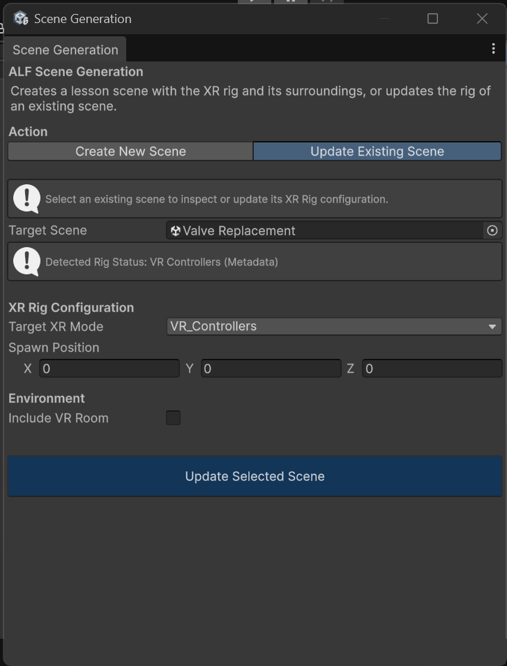

# Change the player setup of an existing scene

**Goal:** switch an existing lesson to a different player setup, for example from controllers to hands, or from VR to AR, without rebuilding the lesson.

## Steps

1. Open **ALF > Scene Generation**.

   

2. At the top, choose **Update Existing Scene**.

   

3. Drag the scene file from the **Project window** into **Target Scene**.
4. Read **Detected Rig Status**. It tells you which player setup the scene has now.
5. Choose the new **Target XR Mode**.
6. For VR, decide whether to tick **Include VR Room**.
7. Press **Update Selected Scene**.

## Result

The old player setup is replaced with the new one, and the scene is saved. Everything else in the scene stays as it was, including your content and an existing VR room.

## Good to know

- **The scene doesn't need to be open.** The update happens in the background.
- **The tool picks the current setup for you.** When you choose a scene, **Target XR Mode** switches to the setup the scene already has. Change it to the one you want before pressing the button.
- **Switching VR to AR doesn't remove a VR room.** If the scene had a VR room, delete it by hand in the Hierarchy, or learners in AR won't see the real room behind it.
- **If you use the main menu,** update it afterwards so its button starts the lesson with the new setup. See [Update the main menu](../../main-menu/how-to/update-the-main-menu.md).
