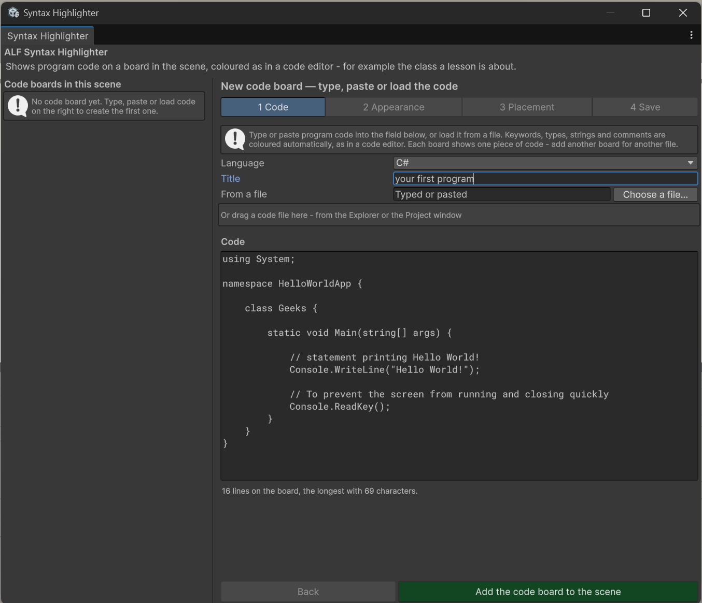
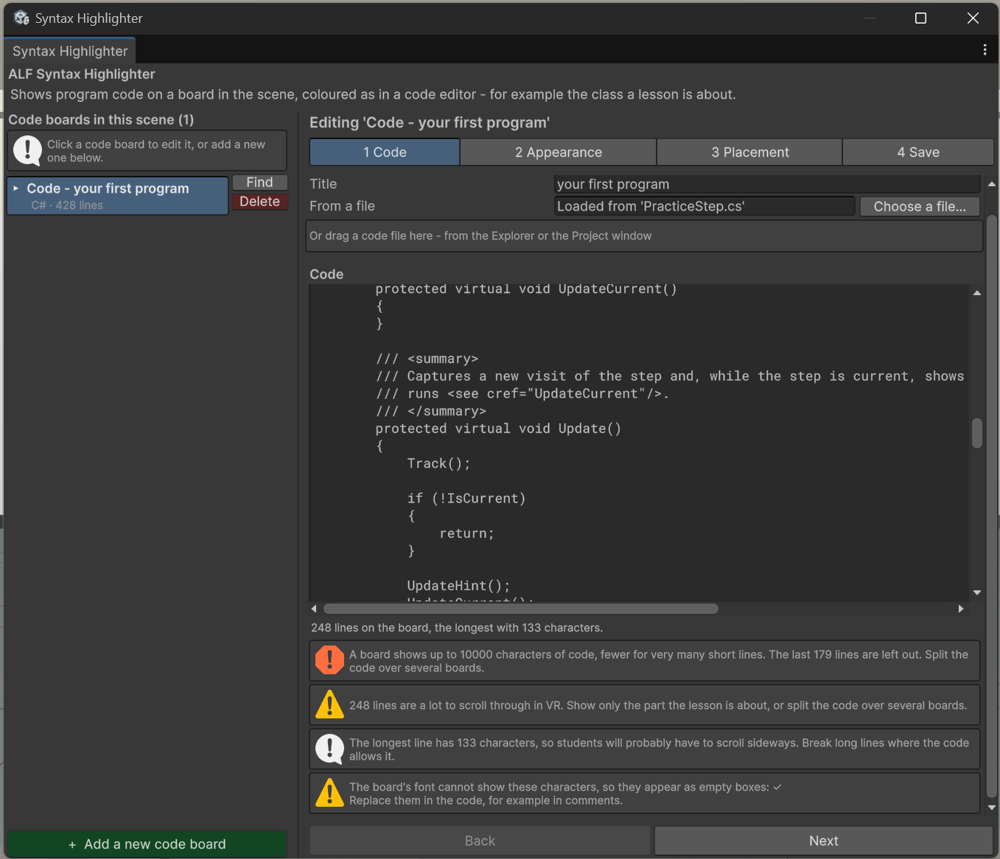

# Add a code board

**Goal:** put a piece of code on a board in the scene.

## Steps

1. Open **ALF > Content Creation > Syntax Highlighter**. The steps are headed **New code board — type, paste or load the code**.
2. In step **1 Code**, choose the **Language**: C#, Java, C or Python.
3. Type a **Title**, for example the file name `Student.cs`. It's shown in a bar above the code. Leave it empty for no bar.
4. Add the code, in one of three ways:
   - **Typed or pasted:** paste it into the code field.
   - **From a file:** press **Choose a file…** and pick the file.
   - **Drag and drop:** drag the file into the window from your file explorer or the **Project window**.

   When you load a file, the language is taken from its ending (`.cs`, `.java`, `.c`, `.h`, `.py`).

   

5. Read the notes under the code. They tell you how many lines the board shows, when it gets very tall or wide, and if the font can't show some characters.

   

6. Press **Add the code board to the scene**.

The board appears in front of the Scene view camera. It's named `Code - ` followed by the title.

7. Set its look in [step 2](./change-the-look.md) and its place in [step 3](./place-the-board.md), then press **Save the scene** in step **4 Save**.

## Good to know

- **Indentation is tidied up.** If every line of the pasted code starts with the same spaces, for example a method copied out of a class, they're removed, so the code starts at the left edge.
- **Very long code is cut off.** A board shows up to about 10,000 characters. The tool warns you. Split long code over several boards.
- **Files up to 128 KB** can be loaded.
