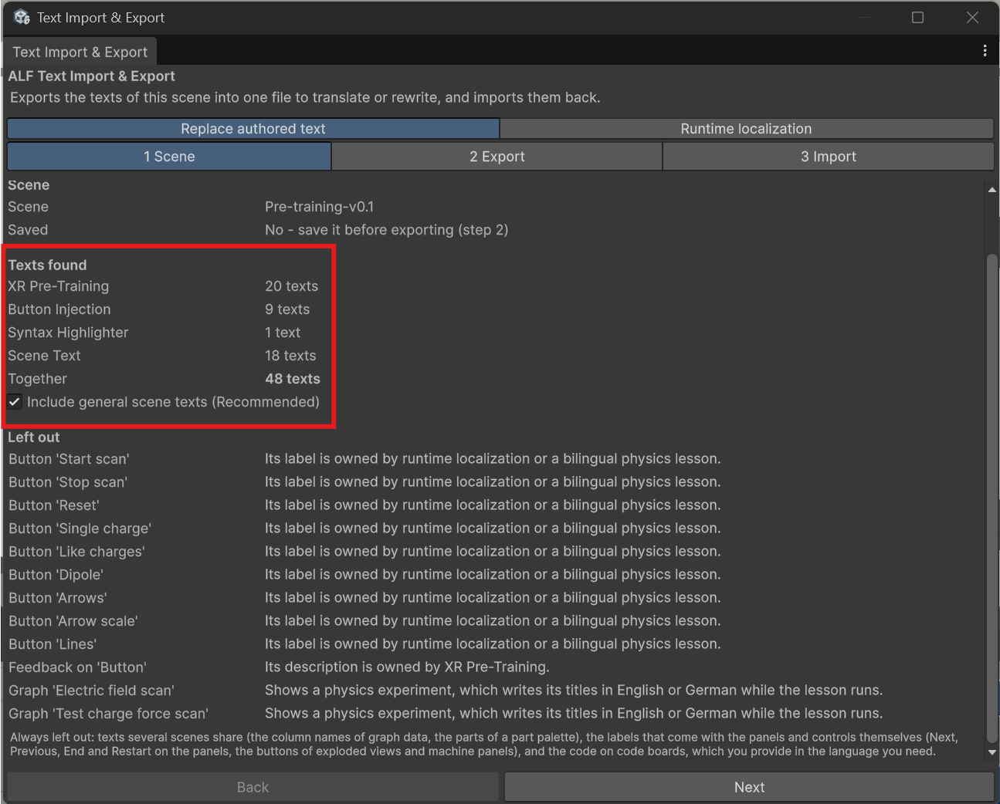

# Before you start

New to Unity? The basic terms (Scene, Hierarchy, Play mode) are explained in [Before you start](../../../before-you-start.md).

## Which tab do I need?

- **Replace authored text** swaps the texts in the scene. Use it to make a German version of an English lesson, to fix wording in many places at once, or to let a colleague proofread all texts in one file. The scene then holds the new texts; the lesson doesn't switch languages while it runs. To keep two languages, keep two exported files.
- **Runtime localization** keeps all languages in the app. Learners switch with a language button in the scene, and the lesson starts in the headset's own language when a translation for it exists. See [Let learners switch languages](./switch-languages.md).

Most of this section is about **Replace authored text**.

## Which texts are included

| Tool | Texts |
|---|---|
| [Scenario Setup](../../scenario-setup/index.md), [Guidance Setup](../../guidance-setup/index.md) | Each step's instruction text |
| [XR Pre-Training](../../xr-pre-training/index.md) | Each practice step's text and its hint |
| Infobox | The infobox text |
| [Button Injection](../../button-injection/index.md) | Button labels |
| [Graphs](../../graphs/index.md) | Title, axis titles, labels of reference lines and bands |
| [Syntax Highlighter](../../syntax-highlighter/index.md) | The code board's title |
| [Motion](../../motion/index.md) | Reference page texts |
| Other texts in the scene | Signs, help texts and other panels no ALF tool owns, when **Include general scene texts** is ticked |

Each text goes back through the tool it belongs to, so it behaves exactly as if you had typed it there.

## Which texts are left out

Step **1 Scene** lists what's left out, with the reason:

- **Physics labs** ([Planetary Lab](../../planetary-lab/index.md), [Electric Field](../../electric-field/index.md)): they come with their own English and German texts.
- **Texts several scenes share**, such as the column names in graph data and the parts on a part palette.
- **Labels built into the panels**, such as **Next**, **Previous**, **End** and **Restart**, and the buttons on Exploded View and machine panels.
- **The code** on code boards.
- The warm-up's success message "✓ Well done!".
- The video player's messages.

## The window

| Step | What you do there |
|---|---|
| **1 Scene** | See the scene, how many texts were found per tool, and what's left out. |
| **2 Export** | Save the scene, copy the instructions for an AI assistant, and export the texts. |
| **3 Import** | Choose the edited file, check what would change, and import. |

:::caution[Not while the scene is playing]
The tool doesn't work in Play mode. Stop Play mode first.
:::
