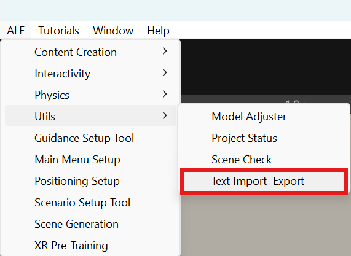
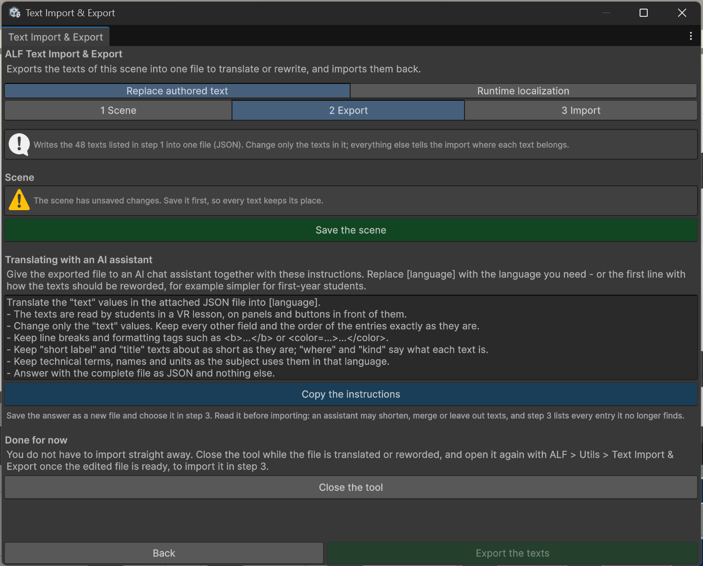

# Export the texts

**Goal:** get all texts of a lesson scene into one file.

## Steps

1. Open the lesson scene.
2. Open **ALF > Utils > Text Import & Export** and choose the tab **Replace authored text**.

   

3. In step **1 Scene**, check the texts found. Tick **Include general scene texts (Recommended)** to also export signs, help texts and other panels that no ALF tool owns.
4. In step **2 Export**, check that the scene is **Saved**. If not, press **Save the scene**. The tool needs a saved scene to find the texts again later.
5. Press **Export the texts** and choose where to save the file.

   

6. The window confirms how many texts were exported and where to.

## Result

A `.json` file with one entry per text. Each entry says where the text appears (for example *Lesson step 1 of 12*), what sort of text it is (instruction, hint, title, short label), and the text itself:

```json
{
  "tool": "Guidance",
  "where": "Lesson step 1 of 12",
  "kind": "instruction",
  "text": "Press the green button on the machine."
}
```

In the real file each entry has a few more fields. **Only change the `text` values.** The other fields tell the tool where each text belongs.

## Next

- Translate the file with an AI chat assistant: [Translate with an AI chat assistant](./translate-with-ai.md).
- Or open it in a text editor (for example Notepad or VS Code) and change the texts by hand. Keep the quotation marks and commas around each text.

You don't have to import straight away. Press **Close the tool**, and come back to step 3 when the file is ready.
