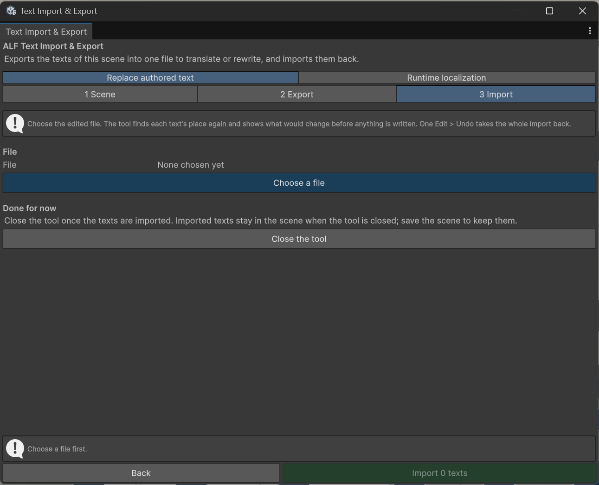

# Import the texts

**Goal:** put the translated or reworded texts back into the scene.

## Steps

1. Open the scene you exported from.
2. Open **ALF > Utils > Text Import & Export**, tab **Replace authored text**, and go to step **3 Import**.
3. Press **Choose a file** and pick the edited file.
4. Check **What would change**. The tool counts the changes per tool and lists the texts:

   | List | What it means | What happens |
   |---|---|---|
   | **Texts that change** | Texts the file changes. | Imported. |
   | Changed in the scene since the export | Someone changed the text in the scene after the export, while the file still has the old text. | Left as they are, unless you tick **Write the file's texts back over these too**. |
   | Different in the scene from when the file was exported | Both the scene and the file changed the text, for example because you imported once already. | Left as they are, unless you tick **Replace these too**. |
   | Not found in this scene | The object was removed, or the text no longer exists. | Skipped. Export again to include new texts. |
   | No text in the file | The entry is empty. | Skipped. |
   | In the file more than once | A text appears twice. | Only the first is used. |

   

5. Press **Import … texts**.
6. Look at the texts in the scene and try the lesson.
7. Press **Save the scene**.

## Result

The texts are in the scene, in the tools they belong to. If a Scenario Setup, Guidance Setup, XR Pre-Training or Button Injection window is open, it shows the new texts straight away.

## Good to know

- **Undo works.** The whole import is one step with **Ctrl+Z**.
- **Nothing is overwritten silently.** A text that was changed in the scene since the export is only replaced when you tick the box for it.
- **Back to the original language.** To go back, import the original export file and tick **Write the file's texts back over these too**.
- **A file from another scene.** The tool asks before importing it. Only texts at exactly the same place are found, for example in a copy of the scene made with **Save As**.
- **The warm-up keeps imported texts.** [XR Pre-Training](../../xr-pre-training/index.md) treats them like your own changes and keeps them when you regenerate, unless you change the language or the player setup.
- **Bending lessons write their texts again** each time you generate them in the [Mesh Deformation](../../mesh-deformation/index.md) tools. Import after the last generate. Step 3 warns about this.
