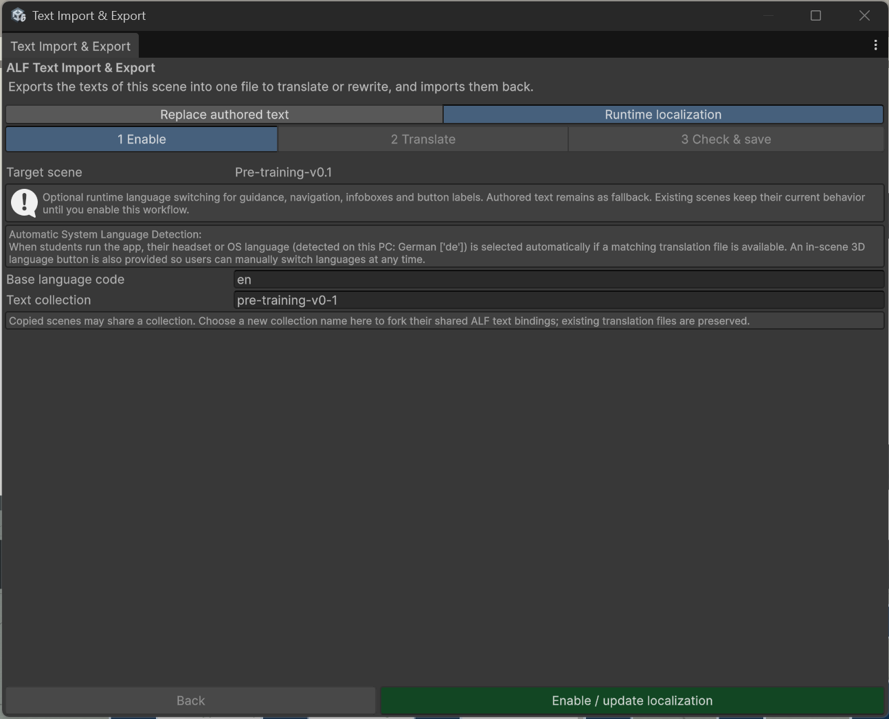
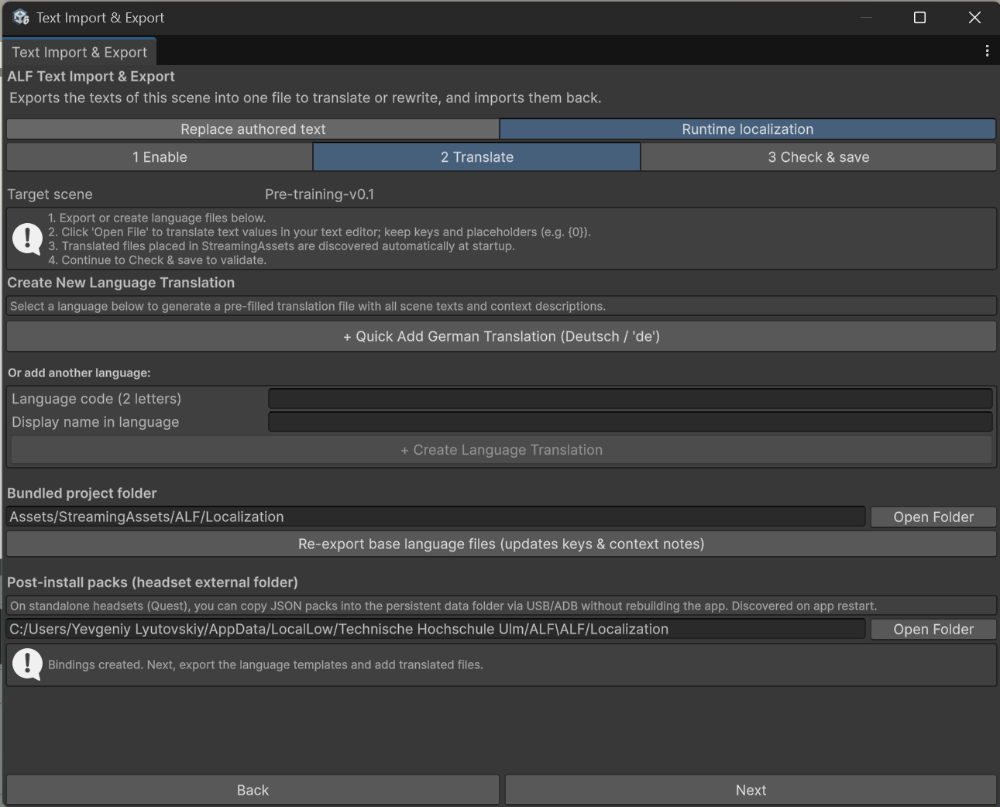
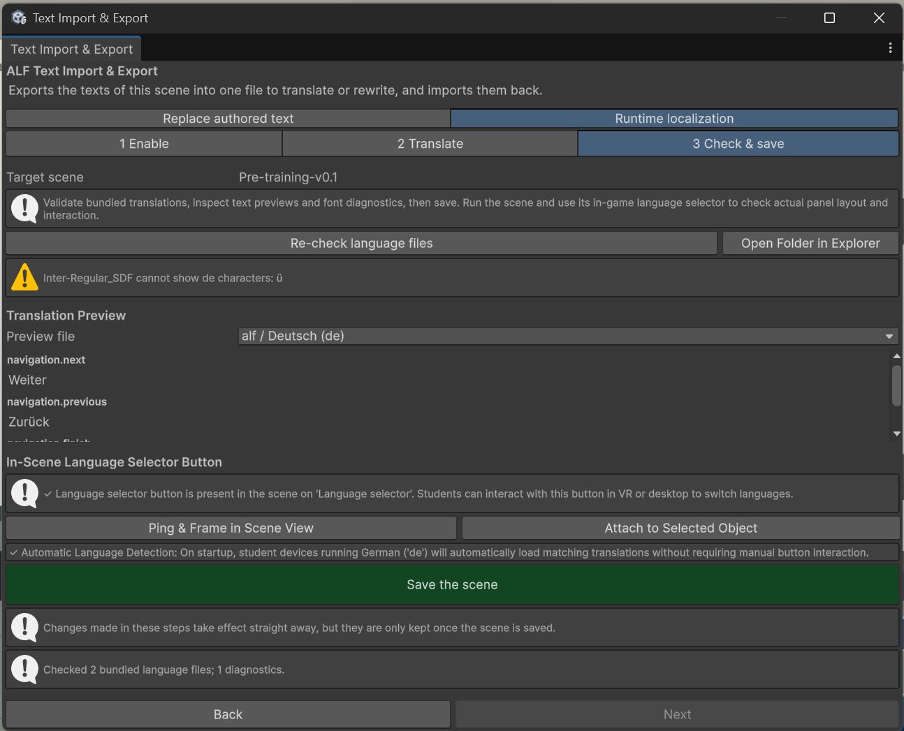

# Let learners switch languages

**Goal:** keep several languages in the lesson, so learners can choose theirs on the headset.

With **Runtime localization**, the app holds a language file per language. When the lesson starts, it uses the headset's own language if a translation exists. Learners can switch at any time with a **language button** in the scene. Their choice is remembered for the next lessons.

Instruction panels, infoboxes and button labels can be translated this way. The texts you wrote in the scene stay as the fallback for anything not translated.

## Step 1: Enable

1. Open the lesson scene and save it.
2. Open **ALF > Utils > Text Import & Export** and choose the tab **Runtime localization**.
3. In **1 Enable**, check:
   - **Base language code**: the language you wrote the lesson in, for example `en` for English or `de` for German.
   - **Text collection**: a name for this lesson's texts. The scene's name is filled in for you.
4. Press **Enable / update localization**.

The tool links the instruction panels, infoboxes and button labels to the language files, and adds a language button to the scene. **Ctrl+Z** undoes this.



## Step 2: Translate

1. Go to **2 Translate**.
2. Create a translation file:
   - For German, press **+ Quick Add German Translation**.
   - For another language, type its **Language code (2 letters)**, for example `fr`, and its **Display name in language**, for example *Français*, then press **+ Create … Translation**.
3. The new file appears under **Existing Language Files**. Press **Open File**. It opens in your text editor, filled with all texts of the scene and a note on where each appears.
4. Translate the text values and save the file. Keep:
   - the keys (the part before the colon),
   - placeholders such as `{0}` or `{mass:F2}`: the app puts numbers there,
   - formatting tags such as `<b>` and `</b>`.



You can also give the file to an AI chat assistant, the same way as in [Translate with an AI chat assistant](./translate-with-ai.md).

When you change texts in the scene later, press **Re-export base language files** so the files get the new texts. Your translations are kept.

## Step 3: Check & save

1. Go to **3 Check & save**. The tool checks the language files for mistakes, missing translations and letters the font can't show. Press **Re-check language files** after editing a file.
2. Under **Translation Preview**, pick a file to read the translated texts.
3. Under **In-Scene Language Selector Button**:
   - **Ping & Frame in Scene View** shows where the language button is.
   - To move it, select an object in the Hierarchy (for example a desk or a panel) and press **Attach to Selected Object**.
   - If there's none, press **Create Language Selector Button**.
4. Save the scene with **Ctrl+S**.
5. Press Play and switch languages with the button, to check how the panels look. The preview in the tool doesn't show the layout.



## Physics labs

The [Planetary Lab](../../planetary-lab/index.md) and the [Electric Field](../../electric-field/index.md) lab come with English and German already. In their setup window, press **Enable runtime localization for this lab**, then **Open Localization & Translation Tool** to continue here.

## Good to know

- **Numbers follow the language.** German shows `0,5`, English `0.5`.
- **Only one way per text.** Texts linked here are skipped by the **Replace authored text** tab, so the two don't overwrite each other.
- **Languages with other scripts** (for example Arabic or Chinese) may need other fonts. Ask the tech team.

<details>
<summary>For the tech team: add a language to an installed app</summary>

A new language can be added to headsets without building the app again:

1. Copy the language file (named `<collection>.<code>.json`, for example `lesson.fr.json`) to the app's folder on the headset: `/sdcard/Android/data/<app-identifier>/files/ALF/Localization/`. Use the USB file connection or adb:

   ```text
   adb shell mkdir -p /sdcard/Android/data/<app-identifier>/files/ALF/Localization
   adb push lesson.fr.json /sdcard/Android/data/<app-identifier>/files/ALF/Localization/
   ```

   Take `<app-identifier>` from the project's build settings.

2. Restart the app. The new language appears on the language button.

**Open Folder** under **Post-install packs** in step 2 shows the same folder on this computer, for testing in the Editor. Language files built into the app are in `Assets/StreamingAssets/ALF/Localization`.

</details>
